::::::::::::::::::::::::::::::::::::: questions

- How do we compare methylation at individual probes between groups?
- How do we define a design matrix and a contrast for limma?
- How do we interpret and visualise differentially methylated probes?

::::::::::::::::::::::::::::::::::::::::::::::::

::::::::::::::::::::::::::::::::::::: objectives

- Extract M-values and beta values from the filtered methylation data
- Define a design matrix and contrast for LNCaP versus PrEC
- Fit probe-wise models and identify differentially methylated probes with limma
- Interpret effect direction, adjusted p-values and beta-value differences
- Plot individual probes and cluster samples using the top-ranked probes

::::::::::::::::::::::::::::::::::::::::::::::::

A differentially methylated probe (DMP) measures a difference in methylation at
an individual probe between the groups of interest. We use M-values for
statistical testing and beta values to visualise methylation levels.

## Load filtered methylation data

Start from the previously saved normalised and filtered objects. The annotation must match our EPICv2 array and hg38 genome build.


``` r
library(minfi)
library(limma)
library(IlluminaHumanMethylationEPICv2anno.20a1.hg38)
library(ComplexHeatmap)
library(dplyr)
library(missMethyl)

mSetFnFlt <- readRDS(file="data/processed/normalised-filtered.rds")
targets <- readRDS(file = "data/processed/targets.rds")
epic <- getAnnotation(IlluminaHumanMethylationEPICv2anno.20a1.hg38)
```

## Global M-values and beta values

Here we look at the global M and Beta values across all probes.
Beta values near zero indicate low methylation; values near one indicate high methylation.
M-values are on a log-ratio scale. Inspect their distributions before fitting the model.


``` r
cols_type <- c(LNCaP = "#D55E00", PREC = "#0072B2")

mVals <- getM(mSetFnFlt)
head(mVals)
```

``` output
                LNCAP_500_1 LNCAP_500_2 LNCAP_500_3 PREC_500_1  PREC_500_2
cg00002271_BC21    1.178715    1.134474    1.056699  0.6097371  0.80528339
cg00004581_TC21    1.552773    1.575081    1.478572 -0.8050771 -0.88887358
cg00005473_TC21    2.278193    2.415690    2.140785  3.3022608  3.16836385
cg00005474_TC21    2.948006    3.189838    2.897238  3.1421097  3.26114640
cg09499020_BC21   -1.857919   -1.581463   -1.736861 -1.7552312 -1.97841104
cg16535257_BC21   -3.538559   -3.506573   -3.697958 -0.1119214  0.06977926
                 PREC_500_3
cg00002271_BC21  0.74405791
cg00004581_TC21 -0.68770543
cg00005473_TC21  2.90294648
cg00005474_TC21  3.54741234
cg09499020_BC21 -1.68665222
cg16535257_BC21  0.05104223
```

``` r
bVals <- getBeta(mSetFnFlt)
head(bVals)
```

``` output
                LNCAP_500_1 LNCAP_500_2 LNCAP_500_3 PREC_500_1 PREC_500_2
cg00002271_BC21  0.69360405  0.68704866  0.67534222  0.6041142  0.6360313
cg00004581_TC21  0.74579314  0.74871353  0.73591981  0.3640018  0.3506644
cg00005473_TC21  0.82908025  0.84216541  0.81515782  0.9079580  0.8999026
cg00005474_TC21  0.88527926  0.90123541  0.88165664  0.8982514  0.9055485
cg09499020_BC21  0.21622345  0.25045506  0.23078215  0.2285294  0.2024050
cg16535257_BC21  0.07923824  0.08087101  0.07154277  0.4806152  0.5120895
                PREC_500_3
cg00002271_BC21  0.6261515
cg00004581_TC21  0.3830361
cg00005473_TC21  0.8820689
cg00005474_TC21  0.9212083
cg09499020_BC21  0.2370180
cg16535257_BC21  0.5088440
```

``` r
densityPlot(bVals, sampGroups=targets$Type, main="Beta values",
            legend=FALSE, xlab="Beta values", pal = cols_type[levels(factor(targets$Type))])
legend("top", legend = levels(factor(targets$Type)),
       text.col=cols_type[levels(factor(targets$Type))], cex = 0.8)
```

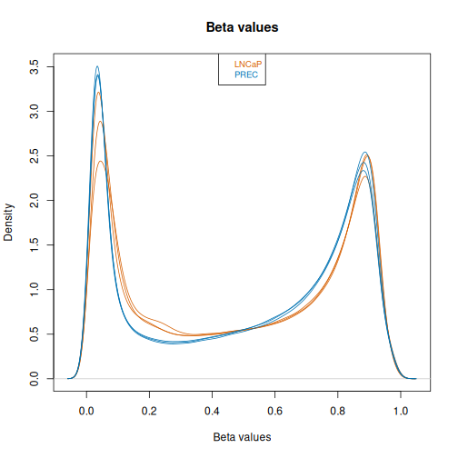

``` r
densityPlot(mVals, sampGroups=targets$Type, main="M-values",
            legend=FALSE, xlab="M-values", pal = cols_type[levels(factor(targets$Type))])
legend("left", legend = levels(factor(targets$Type)),
       text.col=cols_type[levels(factor(targets$Type))], cex = 0.8)
```

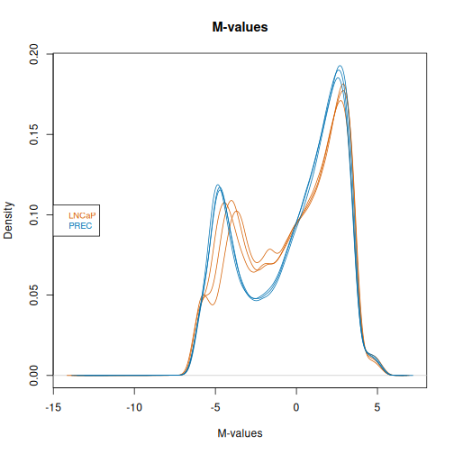

## Define the design matrix and contrasts

We compare LNCaP with PrEC. `~0+sampleType` creates a column for each cell type, without an intercept; each coefficient represents that group's mean M-value. Inspect the design to check that the sample labels are assigned correctly.


``` r
sampleType <- factor(targets$Type)

design <- model.matrix(~0+sampleType, data=targets)
colnames(design) <- levels(sampleType)
design
```

``` output
  LNCaP PREC
1     1    0
2     1    0
3     1    0
4     0    1
5     0    1
6     0    1
attr(,"assign")
[1] 1 1
attr(,"contrasts")
attr(,"contrasts")$sampleType
[1] "contr.treatment"
```

::::::::::::::::::::::::::::::::::::: callout

### Technical replicates versus biological replicates

For this example, we compare one prostate cancer cell line (LNCaP)
with one normal prostate epithelial culture (PrEC), with three technical
replicate arrays for each. These are repeated measurements of the same
biological material, rather than three independent biological samples per group.

In a typical research study, we would use biological replicates: e.g.
tumours from different patients with the same disease type, in each comparison
group. These samples capture biological variation between patients or tumours,
which technical replicates alone cannot represent. Repeating measurements of
one sample does not replace collecting independent biological samples.

For your own study, define the groups using the biological question and account for
the study design, including patient pairing where appropriate. Multiple
tumours from the same patient are related samples and need that relationship
accounted for in the analysis. See the **Blocking and Correlation** section of the
[limma User's Guide](https://bioconductor.org/packages/release/bioc/vignettes/limma/inst/doc/usersguide.pdf) to account for related samples using patient blocks and `duplicateCorrelation()`.

::::::::::::::::::::::::::::::::::::::::::::::::

## Fit models with limma

`lmFit()` fits a linear model at each probe. The contrast `LNCaP-PREC` subtracts the PrEC mean M-value from the LNCaP mean M-value.
`contrasts.fit()` calculates this comparison, and `eBayes()` moderates the variance estimates across probes.

Positive coefficients indicate higher methylation in LNCaP; negative coefficients indicate higher methylation in PrEC.
The summary counts probes with negative significant, non-significant and positive significant results at the default Benjamini–Hochberg adjusted p-value threshold of 0.05 (conventional choice is false dicovery rate 5%).


``` r
fit <- lmFit(mVals, design)
contMatrix <- makeContrasts(LNCaP-PREC,
                           levels=design)
contMatrix
```

``` output
       Contrasts
Levels  LNCaP - PREC
  LNCaP            1
  PREC            -1
```

``` r
fit2 <- contrasts.fit(fit, contMatrix)
fit2 <- eBayes(fit2)

# Differentially methylated CpGs at FDR < 0.05
summary(decideTests(fit2))
```

``` output
       LNCaP - PREC
Down         298607
NotSig       284859
Up           269126
```

## Interpret and visualise differentially methylated probes

We create a results table containing all tested probes, ranked by evidence for differential methylation.

`topTable()` ranks probes by evidence for differential methylation. In the table:

- `logFC` is the difference in mean **M-values** for LNCaP minus PrEC
- `P.Value` is the unadjusted p-value for that probe
- `adj.P.Val` accounts for testing many probes using Benjamini–Hochberg adjustment
- `B` is the log-odds of differential methylation under the fitted model
- `deltaBeta` is the mean beta value in LNCaP minus the mean beta value in PrEC; positive values indicate higher methylation in LNCaP (the magnitude of methylation change)

We then plot the 4 top-ranked probes. These probes are only considered statistically significant if their adjusted p-values meet our FDR threshold.

The four plots show the top-ranked probes, which may or may not pass the FDR
threshold. Check the adjusted p-values before describing them as significant.


``` r
# results table of top differentially methylated probes for this contrast
epicSub <- epic[match(rownames(mVals),epic$Name), ]
DMPs <- topTable(fit2, num=Inf, coef=1, genelist=epicSub)

# Mean beta-value difference: LNCaP minus PrEC
deltaBeta <- rowMeans(bVals[, sampleType == "LNCaP", drop=FALSE]) -
  rowMeans(bVals[, sampleType == "PREC", drop=FALSE])
DMPs$deltaBeta <- deltaBeta[rownames(DMPs)]
head(DMPs)
```

``` output
                 chr       pos strand            Name AddressA AddressB
cg17560015_BC11 chr8 143939081      - cg17560015_BC11 34610510 75619962
cg19868301_BC11 chr7  39733459      - cg19868301_BC11 15670119  2735828
cg27434509_TC11 chr4   5708610      - cg27434509_TC11 56606218 96787208
cg27026819_BC11 chr6   4775460      - cg27026819_BC11 91799528 90753902
cg05175020_TC11 chr7 100477779      - cg05175020_TC11 33784281 68788483
cg13786801_BC11 chr1  58577073      + cg13786801_BC11 29796315 96622375
                                                         ProbeSeqA
cg17560015_BC11 AAAACTCTACACTCTAAAAAAAATTCACTACCCTATCAACAACACACACA
cg19868301_BC11 AACAAACCAAAAAAACCTACATAAACAACTTCATTACAACCAACTTACCA
cg27434509_TC11 CAAACCCCAAATACAAATATTTATTCCAAAAAACTTTCAACAACAACTCA
cg27026819_BC11 AAAATCCAAATTCTAATCAAACAAAACTATCAATAATAATTCCTTTCACA
cg05175020_TC11 CATTTCCAAATAATAAAACTACCCCACAACCTAAAAAAACCTTATCACCA
cg13786801_BC11 ACACACAATCATCTTATTAATAAAACACATACAATTATCCTACACAACCA
                                                         ProbeSeqB Type
cg17560015_BC11 AAAACTCTACGCTCTAAAAAAAATTCGCTACCCTATCAACAACACACGCG    I
cg19868301_BC11 AACAAACCGAAAAAACCTACGTAAACGACTTCGTTACAACCAACTTACCG    I
cg27434509_TC11 CAAACCCCAAATACGAATATTTATTCCAAAAAACTTTCGACGACGACTCG    I
cg27026819_BC11 AAAATCCGAATTCTAATCGAACGAAACTATCAATAATAATTCCTTTCGCG    I
cg05175020_TC11 CGTTTCCGAATAATAAAACTACCCCACGACCTAAAAAAACCTTATCGCCG    I
cg13786801_BC11 ACACACGATCATCTTATTAATAAAACACGTACAATTATCCTACGCGACCG    I
                NextBase Color Probe_rs Probe_maf CpG_rs CpG_maf SBE_rs SBE_maf
cg17560015_BC11        A   Red     <NA>        NA   <NA>      NA   <NA>      NA
cg19868301_BC11        T   Red     <NA>        NA   <NA>      NA   <NA>      NA
cg27434509_TC11        C   Grn     <NA>        NA   <NA>      NA   <NA>      NA
cg27026819_BC11        A   Red     <NA>        NA   <NA>      NA   <NA>      NA
cg05175020_TC11        C   Grn     <NA>        NA   <NA>      NA   <NA>      NA
cg13786801_BC11        T   Red     <NA>        NA   <NA>      NA   <NA>      NA
                                                     Islands_Name
cg17560015_BC11 chr8:143934740-143935239;chr8:143942249-143942748
cg19868301_BC11                            chr7:39733240-39733653
cg27434509_TC11         chr4:5708258-5708768;chr4:5711077-5711724
cg27026819_BC11         chr6:4774897-4776695;chr6:4776923-4777316
cg05175020_TC11 chr7:100477680-100477928;chr7:100478831-100479162
cg13786801_BC11                            chr1:58576085-58577623
                Relation_to_Island col Probe_Type Strand_FR Strand_TB Strand_CO
cg17560015_BC11              Shelf   R         cg         R         B         C
cg19868301_BC11             Island   R         cg         R         B         C
cg27434509_TC11             Island   G         cg         R         T         C
cg27026819_BC11             Island   R         cg         R         B         C
cg05175020_TC11             Island   G         cg         R         T         C
cg13786801_BC11             Island   R         cg         F         B         C
                Infinium_Design Species Rep_Num      UCSC_RefGene_Group
cg17560015_BC11               1   Human       1                        
cg19868301_BC11               1   Human       1                  TSS200
cg27434509_TC11               1   Human       1                  TSS200
cg27026819_BC11               1   Human       1 TSS1500;TSS1500;TSS1500
cg05175020_TC11               1   Human       1    exon_2;exon_2;exon_2
cg13786801_BC11               1   Human       1                  exon_1
                              UCSC_RefGene_Name
cg17560015_BC11                                
cg19868301_BC11                       LINC00265
cg27434509_TC11                            EVC2
cg27026819_BC11                  CDYL;CDYL;CDYL
cg05175020_TC11 TSC22D4;TSC22D4;TSC22D4-C7ORF61
cg13786801_BC11                         TACSTD2
                                   UCSC_RefGene_Accession
cg17560015_BC11                                          
cg19868301_BC11                               NR_026999.1
cg27434509_TC11                               NM_147127.5
cg27026819_BC11 NM_001368127.1;NM_001368126.1;NM_004824.4
cg05175020_TC11 NM_001303043.2;NM_030935.5;NM_001395846.1
cg13786801_BC11                               NM_002353.3
                                                                                     GencodeV41_Group
cg17560015_BC11                                                                                      
cg19868301_BC11 exon_1;exon_1;exon_1;TSS200;TSS200;TSS200;TSS200;TSS200;TSS200;TSS200;TSS1500;TSS1500
cg27434509_TC11                                                                                TSS200
cg27026819_BC11                                                                TSS1500;TSS1500;TSS200
cg05175020_TC11                                                                 exon_2;exon_2;TSS1500
cg13786801_BC11                                                                                exon_1
                                                                                                                                                                                                         GencodeV41_Name
cg17560015_BC11                                                                                                                                                                                                         
cg19868301_BC11 LINC00265;LINC00265;LINC00265;ENSG00000188185.13;ENSG00000188185.13;ENSG00000188185.13;ENSG00000188185.13;ENSG00000188185.13;ENSG00000188185.13;ENSG00000188185.13;ENSG00000188185.13;ENSG00000188185.13
cg27434509_TC11                                                                                                                                                                                       ENSG00000173040.13
cg27026819_BC11                                                                                                                                                  ENSG00000153046.18;ENSG00000153046.18;ENSG00000236336.1
cg05175020_TC11                                                                                                                                                                        TSC22D4;TSC22D4;ENSG00000166925.9
cg13786801_BC11                                                                                                                                                                                                  TACSTD2
                                                                                                                                                                                                                   GencodeV41_Accession
cg17560015_BC11                                                                                                                                                                                                                        
cg19868301_BC11 ENST00000654922.1;ENST00000656108.1;ENST00000666283.1;ENST00000665200.1;ENST00000674829.1;ENST00000656645.1;ENST00000675279.1;ENST00000675949.1;ENST00000340510.8;ENST00000656391.1;ENST00000668152.1;ENST00000658784.1
cg27434509_TC11                                                                                                                                                                                                      ENST00000344408.10
cg27026819_BC11                                                                                                                                                                   ENST00000397588.8;ENST00000472453.5;ENST00000436283.1
cg05175020_TC11                                                                                                                                                                   ENST00000300181.7;ENST00000493217.1;ENST00000496728.1
cg13786801_BC11                                                                                                                                                                                                       ENST00000371225.4
                Phantom5_Enhancers            HMM_Island
cg17560015_BC11                    8:143937965-143941336
cg19868301_BC11                                         
cg27434509_TC11                                         
cg27026819_BC11                                         
cg05175020_TC11                                         
cg13786801_BC11                                         
                Regulatory_Feature_Group Methyl450_Enhancer DMR Methyl450_Loci
cg17560015_BC11      Promoter_Associated               TRUE         cg17560015
cg19868301_BC11      Promoter_Associated               TRUE         cg19868301
cg27434509_TC11                                       FALSE         cg27434509
cg27026819_BC11                                       FALSE                   
cg05175020_TC11                                       FALSE         cg05175020
cg13786801_BC11                                       FALSE         cg13786801
                Methyl27_Loci EPICv1_Loci Manifest_probe_match    logFC
cg17560015_BC11                cg17560015                 TRUE 11.21626
cg19868301_BC11                cg19868301                 TRUE 11.50734
cg27434509_TC11                cg27434509                 TRUE 11.94057
cg27026819_BC11                cg27026819                FALSE 11.56923
cg05175020_TC11                cg05175020                 TRUE 10.98314
cg13786801_BC11                cg13786801                 TRUE 11.14453
                   AveExpr        t      P.Value    adj.P.Val        B
cg17560015_BC11 -0.5128343 89.51183 6.977386e-14 1.066004e-09 19.91515
cg19868301_BC11 -0.4822067 89.09286 7.259349e-14 1.066004e-09 19.89886
cg27434509_TC11 -0.6285207 88.90501 7.389893e-14 1.066004e-09 19.89150
cg27026819_BC11 -0.2062718 88.15574 7.937340e-14 1.066004e-09 19.86179
cg05175020_TC11 -0.7451818 87.54970 8.413414e-14 1.066004e-09 19.83735
cg13786801_BC11 -0.5976520 87.53230 8.427540e-14 1.066004e-09 19.83664
                deltaBeta
cg17560015_BC11 0.9574039
cg19868301_BC11 0.9616437
cg27434509_TC11 0.9656910
cg27026819_BC11 0.9639821
cg05175020_TC11 0.9509826
cg13786801_BC11 0.9554555
```

``` r
# Plot the four top-ranked CpGs
par(mfrow=c(2,2))
sapply(rownames(DMPs)[1:4], function(cpg){
  plotCpg(bVals, cpg=cpg, pheno=targets$Type, ylab="Beta values")
})
```

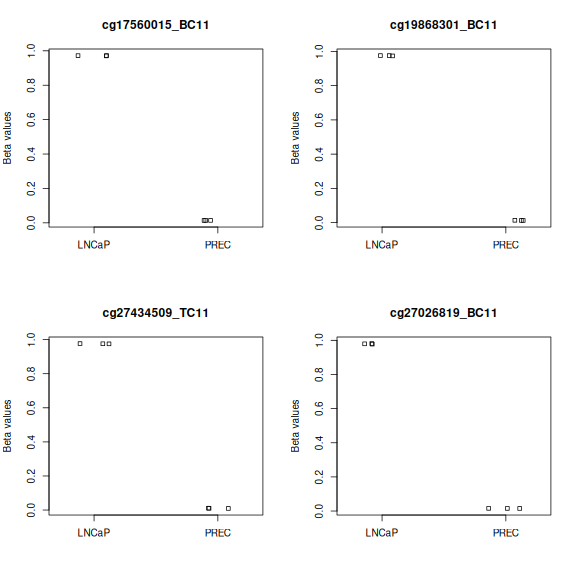

``` output
$cg17560015_BC11
NULL

$cg19868301_BC11
NULL

$cg27434509_TC11
NULL

$cg27026819_BC11
NULL
```

To save the full results table locally, run the following code. This export is
skipped when building the lesson website because the annotated table is too large
to include in the published site.


``` r
dir.create("data/output", recursive = TRUE, showWarnings = FALSE)
write.table(DMPs, file="data/output/DMPs_epicv2_LNCaP_vs_PREC.csv", sep=",", row.names=FALSE)
```

We can also extract only the statistically significant probes, retaining their
statistics, annotation and beta-value differences.


``` r
sigDMPs <- DMPs[DMPs$adj.P.Val < 0.05, ]
nrow(sigDMPs)
```

``` output
[1] 567733
```

``` r
head(sigDMPs)
```

``` output
                 chr       pos strand            Name AddressA AddressB
cg17560015_BC11 chr8 143939081      - cg17560015_BC11 34610510 75619962
cg19868301_BC11 chr7  39733459      - cg19868301_BC11 15670119  2735828
cg27434509_TC11 chr4   5708610      - cg27434509_TC11 56606218 96787208
cg27026819_BC11 chr6   4775460      - cg27026819_BC11 91799528 90753902
cg05175020_TC11 chr7 100477779      - cg05175020_TC11 33784281 68788483
cg13786801_BC11 chr1  58577073      + cg13786801_BC11 29796315 96622375
                                                         ProbeSeqA
cg17560015_BC11 AAAACTCTACACTCTAAAAAAAATTCACTACCCTATCAACAACACACACA
cg19868301_BC11 AACAAACCAAAAAAACCTACATAAACAACTTCATTACAACCAACTTACCA
cg27434509_TC11 CAAACCCCAAATACAAATATTTATTCCAAAAAACTTTCAACAACAACTCA
cg27026819_BC11 AAAATCCAAATTCTAATCAAACAAAACTATCAATAATAATTCCTTTCACA
cg05175020_TC11 CATTTCCAAATAATAAAACTACCCCACAACCTAAAAAAACCTTATCACCA
cg13786801_BC11 ACACACAATCATCTTATTAATAAAACACATACAATTATCCTACACAACCA
                                                         ProbeSeqB Type
cg17560015_BC11 AAAACTCTACGCTCTAAAAAAAATTCGCTACCCTATCAACAACACACGCG    I
cg19868301_BC11 AACAAACCGAAAAAACCTACGTAAACGACTTCGTTACAACCAACTTACCG    I
cg27434509_TC11 CAAACCCCAAATACGAATATTTATTCCAAAAAACTTTCGACGACGACTCG    I
cg27026819_BC11 AAAATCCGAATTCTAATCGAACGAAACTATCAATAATAATTCCTTTCGCG    I
cg05175020_TC11 CGTTTCCGAATAATAAAACTACCCCACGACCTAAAAAAACCTTATCGCCG    I
cg13786801_BC11 ACACACGATCATCTTATTAATAAAACACGTACAATTATCCTACGCGACCG    I
                NextBase Color Probe_rs Probe_maf CpG_rs CpG_maf SBE_rs SBE_maf
cg17560015_BC11        A   Red     <NA>        NA   <NA>      NA   <NA>      NA
cg19868301_BC11        T   Red     <NA>        NA   <NA>      NA   <NA>      NA
cg27434509_TC11        C   Grn     <NA>        NA   <NA>      NA   <NA>      NA
cg27026819_BC11        A   Red     <NA>        NA   <NA>      NA   <NA>      NA
cg05175020_TC11        C   Grn     <NA>        NA   <NA>      NA   <NA>      NA
cg13786801_BC11        T   Red     <NA>        NA   <NA>      NA   <NA>      NA
                                                     Islands_Name
cg17560015_BC11 chr8:143934740-143935239;chr8:143942249-143942748
cg19868301_BC11                            chr7:39733240-39733653
cg27434509_TC11         chr4:5708258-5708768;chr4:5711077-5711724
cg27026819_BC11         chr6:4774897-4776695;chr6:4776923-4777316
cg05175020_TC11 chr7:100477680-100477928;chr7:100478831-100479162
cg13786801_BC11                            chr1:58576085-58577623
                Relation_to_Island col Probe_Type Strand_FR Strand_TB Strand_CO
cg17560015_BC11              Shelf   R         cg         R         B         C
cg19868301_BC11             Island   R         cg         R         B         C
cg27434509_TC11             Island   G         cg         R         T         C
cg27026819_BC11             Island   R         cg         R         B         C
cg05175020_TC11             Island   G         cg         R         T         C
cg13786801_BC11             Island   R         cg         F         B         C
                Infinium_Design Species Rep_Num      UCSC_RefGene_Group
cg17560015_BC11               1   Human       1                        
cg19868301_BC11               1   Human       1                  TSS200
cg27434509_TC11               1   Human       1                  TSS200
cg27026819_BC11               1   Human       1 TSS1500;TSS1500;TSS1500
cg05175020_TC11               1   Human       1    exon_2;exon_2;exon_2
cg13786801_BC11               1   Human       1                  exon_1
                              UCSC_RefGene_Name
cg17560015_BC11                                
cg19868301_BC11                       LINC00265
cg27434509_TC11                            EVC2
cg27026819_BC11                  CDYL;CDYL;CDYL
cg05175020_TC11 TSC22D4;TSC22D4;TSC22D4-C7ORF61
cg13786801_BC11                         TACSTD2
                                   UCSC_RefGene_Accession
cg17560015_BC11                                          
cg19868301_BC11                               NR_026999.1
cg27434509_TC11                               NM_147127.5
cg27026819_BC11 NM_001368127.1;NM_001368126.1;NM_004824.4
cg05175020_TC11 NM_001303043.2;NM_030935.5;NM_001395846.1
cg13786801_BC11                               NM_002353.3
                                                                                     GencodeV41_Group
cg17560015_BC11                                                                                      
cg19868301_BC11 exon_1;exon_1;exon_1;TSS200;TSS200;TSS200;TSS200;TSS200;TSS200;TSS200;TSS1500;TSS1500
cg27434509_TC11                                                                                TSS200
cg27026819_BC11                                                                TSS1500;TSS1500;TSS200
cg05175020_TC11                                                                 exon_2;exon_2;TSS1500
cg13786801_BC11                                                                                exon_1
                                                                                                                                                                                                         GencodeV41_Name
cg17560015_BC11                                                                                                                                                                                                         
cg19868301_BC11 LINC00265;LINC00265;LINC00265;ENSG00000188185.13;ENSG00000188185.13;ENSG00000188185.13;ENSG00000188185.13;ENSG00000188185.13;ENSG00000188185.13;ENSG00000188185.13;ENSG00000188185.13;ENSG00000188185.13
cg27434509_TC11                                                                                                                                                                                       ENSG00000173040.13
cg27026819_BC11                                                                                                                                                  ENSG00000153046.18;ENSG00000153046.18;ENSG00000236336.1
cg05175020_TC11                                                                                                                                                                        TSC22D4;TSC22D4;ENSG00000166925.9
cg13786801_BC11                                                                                                                                                                                                  TACSTD2
                                                                                                                                                                                                                   GencodeV41_Accession
cg17560015_BC11                                                                                                                                                                                                                        
cg19868301_BC11 ENST00000654922.1;ENST00000656108.1;ENST00000666283.1;ENST00000665200.1;ENST00000674829.1;ENST00000656645.1;ENST00000675279.1;ENST00000675949.1;ENST00000340510.8;ENST00000656391.1;ENST00000668152.1;ENST00000658784.1
cg27434509_TC11                                                                                                                                                                                                      ENST00000344408.10
cg27026819_BC11                                                                                                                                                                   ENST00000397588.8;ENST00000472453.5;ENST00000436283.1
cg05175020_TC11                                                                                                                                                                   ENST00000300181.7;ENST00000493217.1;ENST00000496728.1
cg13786801_BC11                                                                                                                                                                                                       ENST00000371225.4
                Phantom5_Enhancers            HMM_Island
cg17560015_BC11                    8:143937965-143941336
cg19868301_BC11                                         
cg27434509_TC11                                         
cg27026819_BC11                                         
cg05175020_TC11                                         
cg13786801_BC11                                         
                Regulatory_Feature_Group Methyl450_Enhancer DMR Methyl450_Loci
cg17560015_BC11      Promoter_Associated               TRUE         cg17560015
cg19868301_BC11      Promoter_Associated               TRUE         cg19868301
cg27434509_TC11                                       FALSE         cg27434509
cg27026819_BC11                                       FALSE                   
cg05175020_TC11                                       FALSE         cg05175020
cg13786801_BC11                                       FALSE         cg13786801
                Methyl27_Loci EPICv1_Loci Manifest_probe_match    logFC
cg17560015_BC11                cg17560015                 TRUE 11.21626
cg19868301_BC11                cg19868301                 TRUE 11.50734
cg27434509_TC11                cg27434509                 TRUE 11.94057
cg27026819_BC11                cg27026819                FALSE 11.56923
cg05175020_TC11                cg05175020                 TRUE 10.98314
cg13786801_BC11                cg13786801                 TRUE 11.14453
                   AveExpr        t      P.Value    adj.P.Val        B
cg17560015_BC11 -0.5128343 89.51183 6.977386e-14 1.066004e-09 19.91515
cg19868301_BC11 -0.4822067 89.09286 7.259349e-14 1.066004e-09 19.89886
cg27434509_TC11 -0.6285207 88.90501 7.389893e-14 1.066004e-09 19.89150
cg27026819_BC11 -0.2062718 88.15574 7.937340e-14 1.066004e-09 19.86179
cg05175020_TC11 -0.7451818 87.54970 8.413414e-14 1.066004e-09 19.83735
cg13786801_BC11 -0.5976520 87.53230 8.427540e-14 1.066004e-09 19.83664
                deltaBeta
cg17560015_BC11 0.9574039
cg19868301_BC11 0.9616437
cg27434509_TC11 0.9656910
cg27026819_BC11 0.9639821
cg05175020_TC11 0.9509826
cg13786801_BC11 0.9554555
```

::::::::::::::::::::::::::::::::::::: challenge

### Interpret the contrast

1. A probe has `logFC = -2` and `adj.P.Val = 0.01`. Which cell type has higher methylation?
2. Does this mean methylation differs by two percentage points?
3. What would happen to the sign and significance if we used `PREC-LNCaP`?

:::::::::::::::::::::::: solution

### Solution

1. PrEC has higher mean M-values for this probe.
2. No. `logFC` is an M-value difference. Inspect `deltaBeta` and the beta-value plot for an interpretable effect size.
3. The coefficient and effect direction reverse. The two-sided p-values and adjusted p-values remain the same.

:::::::::::::::::::::::::::::::::
::::::::::::::::::::::::::::::::::::::::::::::::

## Plot specific genes of interest

We explore GSTP1 and APC, genes with documented promoter methylation in prostate cancer models. See the studies of [GSTP1 in LNCaP](https://pmc.ncbi.nlm.nih.gov/articles/PMC1867052/) and [LNCaP versus PrEC methylation](https://pmc.ncbi.nlm.nih.gov/articles/PMC3129246/).

We can plot the methylation profiles of specific genes of interest 
* To do this, we find any relevant probes relating to the target gene by searching the reference (epic dataframe)
* Note: We are typically most interested in probes relating to the promoter region of genes. Therefore, for genes that have a large number of probes, you may choose to only focus on the probes relating to the promoter region. We can filter probes in this region by refining our search to CpG 'islands' that are typically located in or near promoter regions (this information can be found in the `Relation_to_Island` column). For a more precise search, we can also filter probes in the promoter region by refining our search to probes located within 200 base pairs (`TSS200`) and 1500 base pairs (`TSS1500`) upstream of the transcriptional start site (TSS) - both of which are typically considered parts of the promoter region (this information can be found in the `UCSC_RefGene_Group` column). You will need to play around with these parameters to suit your analysis of interest.


``` r
# GSTP1 - search for related probes
applicable_probes <- as.data.frame(epicSub) %>%
  filter(grepl("\\bGSTP1\\b", UCSC_RefGene_Name))
applicable_probes
```

``` output
                  chr      pos strand            Name AddressA AddressB
cg25135322_TC21 chr11 67582682      + cg25135322_TC21 26621902         
cg23725454_TC21 chr11 67582724      - cg23725454_TC21 88716579         
cg25866895_TC21 chr11 67582855      + cg25866895_TC21 83711100         
cg05244766_BC21 chr11 67583028      + cg05244766_BC21 54717876         
cg14921275_TC21 chr11 67583040      + cg14921275_TC21 62604317         
cg02659086_BC11 chr11 67583505      + cg02659086_BC11 40619483 44805599
cg04920951_BC11 chr11 67583800      + cg04920951_BC11 13719987 64798834
cg09038676_BC21 chr11 67584137      - cg09038676_BC21 47617879         
cg22224704_BC21 chr11 67584570      + cg22224704_BC21 56725287         
cg07493922_TC21 chr11 67584751      - cg07493922_TC21 48741870         
                                                         ProbeSeqA
cg25135322_TC21 AAACAACAAAACCAAAAAAAATAACCTAAAACACAACCACTAAAAAAAAC
cg23725454_TC21 CATACRATCTCRCTAATTTTCTATTCCTATATAAATTTACTAAAACTAAC
cg25866895_TC21 AAACACATAATCACATAACRACRATCAACACACACTAATACCTATTAAAC
cg05244766_BC21 CATCCTCTACATATACCCCAAAACTTCAAATAAAAATTAAACRACCAAAC
cg14921275_TC21 ATACCCCAAAACTTCAAATAAAAATTAAACRACCAAACRTAATAACTCAC
cg02659086_BC11 ACAAATATACAAACTCCAAAATCACAACAATCTTAAAAAATTTCCCCCCA
cg04920951_BC11 AACACTAAAACAAAACAAAACAAAACCACCCTTATAAAACTCAAAAACCA
cg09038676_BC21 CCAAACACATACTCCTACCTCRAACTAAAAAATAAACCACRATATAAAAC
cg22224704_BC21 AAATAATAACCRTAAAAACRTAACAAAAAAACTCACTCAAAACCTCCTAC
cg07493922_TC21 TACCCTAAACTTAAAAATTCAAAACTCACCAAAAATACRACCCAAATAAC
                                                         ProbeSeqB Type
cg25135322_TC21                                                      II
cg23725454_TC21                                                      II
cg25866895_TC21                                                      II
cg05244766_BC21                                                      II
cg14921275_TC21                                                      II
cg02659086_BC11 ACGAATATACAAACTCCGAAATCGCAACGATCTTAAAAAATTTCCCCCCG    I
cg04920951_BC11 AACACTAAAACGAAACGAAACGAAACCACCCTTATAAAACTCGAAAACCG    I
cg09038676_BC21                                                      II
cg22224704_BC21                                                      II
cg07493922_TC21                                                      II
                NextBase Color   Probe_rs Probe_maf CpG_rs CpG_maf SBE_rs
cg25135322_TC21                      <NA>        NA   <NA>      NA   <NA>
cg23725454_TC21                      <NA>        NA   <NA>      NA   <NA>
cg25866895_TC21                      <NA>        NA   <NA>      NA   <NA>
cg05244766_BC21                 rs8191435  0.024760   <NA>      NA   <NA>
cg14921275_TC21                 rs8191435  0.024760   <NA>      NA   <NA>
cg02659086_BC11        C   Grn rs36211089  0.310503   <NA>      NA   <NA>
cg04920951_BC11        C   Grn  rs8191439  0.082185   <NA>      NA   <NA>
cg09038676_BC21                 rs4147581  0.488530   <NA>      NA   <NA>
cg22224704_BC21                      <NA>        NA   <NA>      NA   <NA>
cg07493922_TC21                      <NA>        NA   <NA>      NA   <NA>
                SBE_maf            Islands_Name Relation_to_Island col
cg25135322_TC21      NA chr11:67583457-67584482              Shore    
cg23725454_TC21      NA chr11:67583457-67584482              Shore    
cg25866895_TC21      NA chr11:67583457-67584482              Shore    
cg05244766_BC21      NA chr11:67583457-67584482              Shore    
cg14921275_TC21      NA chr11:67583457-67584482              Shore    
cg02659086_BC11      NA chr11:67583457-67584482             Island   G
cg04920951_BC11      NA chr11:67583457-67584482             Island   G
cg09038676_BC21      NA chr11:67583457-67584482             Island    
cg22224704_BC21      NA chr11:67583457-67584482              Shore    
cg07493922_TC21      NA chr11:67583457-67584482              Shore    
                Probe_Type Strand_FR Strand_TB Strand_CO Infinium_Design
cg25135322_TC21         cg         F         T         C               2
cg23725454_TC21         cg         R         T         C               2
cg25866895_TC21         cg         F         T         C               2
cg05244766_BC21         cg         F         B         C               2
cg14921275_TC21         cg         F         T         C               2
cg02659086_BC11         cg         F         B         C               1
cg04920951_BC11         cg         F         B         C               1
cg09038676_BC21         cg         R         B         C               2
cg22224704_BC21         cg         F         B         C               2
cg07493922_TC21         cg         R         T         C               2
                Species Rep_Num UCSC_RefGene_Group UCSC_RefGene_Name
cg25135322_TC21   Human       1            TSS1500             GSTP1
cg23725454_TC21   Human       1            TSS1500             GSTP1
cg25866895_TC21   Human       1            TSS1500             GSTP1
cg05244766_BC21   Human       1            TSS1500             GSTP1
cg14921275_TC21   Human       1            TSS1500             GSTP1
cg02659086_BC11   Human       1            TSS1500             GSTP1
cg04920951_BC11   Human       1             TSS200             GSTP1
cg09038676_BC21   Human       1             exon_2             GSTP1
cg22224704_BC21   Human       1             exon_3             GSTP1
cg07493922_TC21   Human       1             exon_4             GSTP1
                UCSC_RefGene_Accession
cg25135322_TC21            NM_000852.4
cg23725454_TC21            NM_000852.4
cg25866895_TC21            NM_000852.4
cg05244766_BC21            NM_000852.4
cg14921275_TC21            NM_000852.4
cg02659086_BC11            NM_000852.4
cg04920951_BC11            NM_000852.4
cg09038676_BC21            NM_000852.4
cg22224704_BC21            NM_000852.4
cg07493922_TC21            NM_000852.4
                                                        GencodeV41_Group
cg25135322_TC21                  TSS1500;TSS1500;TSS1500;TSS1500;TSS1500
cg23725454_TC21                  TSS1500;TSS1500;TSS1500;TSS1500;TSS1500
cg25866895_TC21                  TSS1500;TSS1500;TSS1500;TSS1500;TSS1500
cg05244766_BC21          TSS1500;TSS1500;TSS1500;TSS1500;TSS1500;TSS1500
cg14921275_TC21          TSS1500;TSS1500;TSS1500;TSS1500;TSS1500;TSS1500
cg02659086_BC11  TSS1500;TSS1500;TSS1500;TSS1500;TSS1500;TSS1500;TSS1500
cg04920951_BC11 exon_1;5UTR;TSS200;TSS200;TSS200;TSS1500;TSS1500;TSS1500
cg09038676_BC21       exon_2;exon_2;exon_2;exon_2;exon_1;TSS1500;TSS1500
cg22224704_BC21               exon_3;exon_3;exon_2;exon_2;exon_1;TSS1500
cg07493922_TC21 exon_4;exon_4;exon_2;exon_3;exon_3;exon_2;TSS200;TSS1500
                                                                                                                                     GencodeV41_Name
cg25135322_TC21                                       ENSG00000084207.18;ENSG00000084207.18;ENSG00000084207.18;ENSG00000084207.18;ENSG00000084207.18
cg23725454_TC21                                       ENSG00000084207.18;ENSG00000084207.18;ENSG00000084207.18;ENSG00000084207.18;ENSG00000084207.18
cg25866895_TC21                                       ENSG00000084207.18;ENSG00000084207.18;ENSG00000084207.18;ENSG00000084207.18;ENSG00000084207.18
cg05244766_BC21                    ENSG00000084207.18;ENSG00000084207.18;ENSG00000084207.18;ENSG00000084207.18;ENSG00000084207.18;ENSG00000084207.18
cg14921275_TC21                    ENSG00000084207.18;ENSG00000084207.18;ENSG00000084207.18;ENSG00000084207.18;ENSG00000084207.18;ENSG00000084207.18
cg02659086_BC11 ENSG00000084207.18;ENSG00000084207.18;ENSG00000084207.18;ENSG00000084207.18;ENSG00000084207.18;ENSG00000084207.18;ENSG00000084207.18
cg04920951_BC11        GSTP1;GSTP1;ENSG00000084207.18;ENSG00000084207.18;ENSG00000084207.18;ENSG00000084207.18;ENSG00000084207.18;ENSG00000084207.18
cg09038676_BC21                                                                  GSTP1;GSTP1;GSTP1;GSTP1;GSTP1;ENSG00000084207.18;ENSG00000084207.18
cg22224704_BC21                                                                                     GSTP1;GSTP1;GSTP1;GSTP1;GSTP1;ENSG00000084207.18
cg07493922_TC21                                                            GSTP1;GSTP1;GSTP1;GSTP1;GSTP1;GSTP1;ENSG00000084207.18;ENSG00000084207.18
                                                                                                                                            GencodeV41_Accession
cg25135322_TC21                                                       ENST00000398603.6;ENST00000398606.10;ENST00000494593.1;ENST00000646888.1;ENST00000489040.1
cg23725454_TC21                                                       ENST00000398603.6;ENST00000398606.10;ENST00000494593.1;ENST00000646888.1;ENST00000489040.1
cg25866895_TC21                                                       ENST00000398603.6;ENST00000398606.10;ENST00000494593.1;ENST00000646888.1;ENST00000489040.1
cg05244766_BC21                                     ENST00000398603.6;ENST00000398606.10;ENST00000494593.1;ENST00000646888.1;ENST00000489040.1;ENST00000498765.5
cg14921275_TC21                                     ENST00000398603.6;ENST00000398606.10;ENST00000494593.1;ENST00000646888.1;ENST00000489040.1;ENST00000498765.5
cg02659086_BC11                   ENST00000398603.6;ENST00000398606.10;ENST00000494593.1;ENST00000646888.1;ENST00000489040.1;ENST00000498765.5;ENST00000467591.1
cg04920951_BC11 ENST00000398603.6;ENST00000398603.6;ENST00000398606.10;ENST00000494593.1;ENST00000646888.1;ENST00000489040.1;ENST00000498765.5;ENST00000467591.1
cg09038676_BC21                   ENST00000398603.6;ENST00000398606.10;ENST00000494593.1;ENST00000646888.1;ENST00000489040.1;ENST00000498765.5;ENST00000467591.1
cg22224704_BC21                                     ENST00000398603.6;ENST00000398606.10;ENST00000494593.1;ENST00000489040.1;ENST00000498765.5;ENST00000467591.1
cg07493922_TC21 ENST00000398603.6;ENST00000398606.10;ENST00000494593.1;ENST00000646888.1;ENST00000489040.1;ENST00000498765.5;ENST00000467591.1;ENST00000495996.1
                Phantom5_Enhancers HMM_Island Regulatory_Feature_Group
cg25135322_TC21                                                       
cg23725454_TC21                                                       
cg25866895_TC21                                                       
cg05244766_BC21                                                       
cg14921275_TC21                                                       
cg02659086_BC11                                    Promoter_Associated
cg04920951_BC11                                    Promoter_Associated
cg09038676_BC21                                    Promoter_Associated
cg22224704_BC21                                    Promoter_Associated
cg07493922_TC21                                    Promoter_Associated
                Methyl450_Enhancer DMR Methyl450_Loci Methyl27_Loci EPICv1_Loci
cg25135322_TC21              FALSE         cg25135322                cg25135322
cg23725454_TC21              FALSE         cg23725454                cg23725454
cg25866895_TC21              FALSE         cg25866895                cg25866895
cg05244766_BC21              FALSE         cg05244766    cg05244766  cg05244766
cg14921275_TC21              FALSE         cg14921275                          
cg02659086_BC11               TRUE         cg02659086    cg02659086  cg02659086
cg04920951_BC11               TRUE         cg04920951    cg04920951  cg04920951
cg09038676_BC21               TRUE         cg09038676    cg09038676  cg09038676
cg22224704_BC21               TRUE         cg22224704    cg22224704  cg22224704
cg07493922_TC21               TRUE                                   cg07493922
                Manifest_probe_match
cg25135322_TC21                 TRUE
cg23725454_TC21                 TRUE
cg25866895_TC21                 TRUE
cg05244766_BC21                 TRUE
cg14921275_TC21                FALSE
cg02659086_BC11                 TRUE
cg04920951_BC11                 TRUE
cg09038676_BC21                 TRUE
cg22224704_BC21                 TRUE
cg07493922_TC21                FALSE
```

``` r
# Two GSTP1 probes annotated as both promoter-associated and within a CpG island (cg04920951_BC11, cg02659086_BC11). There are another five probes which are promoter-associated (TSS1500) but lie in an island shore. 

# Plot the two promoter-associated CpG-island probes for GSTP1.
geneMap <- c("cg04920951_BC11" = "GSTP1", "cg02659086_BC11" = "GSTP1")
lapply(names(geneMap), function(probeID) {
  plotCpg(bVals, cpg=probeID, pheno=targets$Type,
          mainPrefix=paste(geneMap[probeID], "-"), ylab="Beta values")
})
```

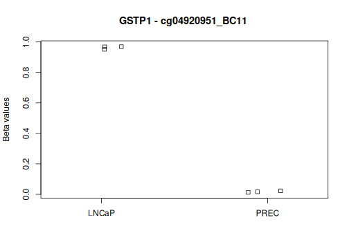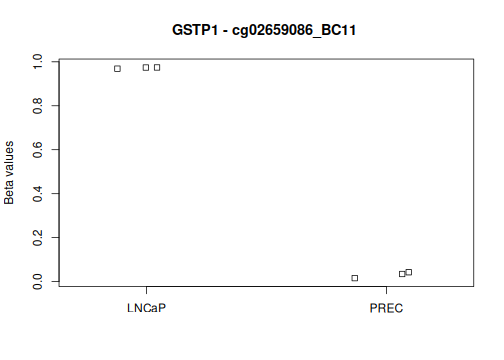

``` output
[[1]]
NULL

[[2]]
NULL
```

``` r
# APC - search for related probes
applicable_probes <- as.data.frame(epicSub) %>%
  filter(grepl("\\bAPC\\b", UCSC_RefGene_Name))
applicable_probes
```

``` output
                 chr       pos strand            Name AddressA AddressB
cg19115695_BC21 chr5 112706150      - cg19115695_BC21  4659456         
cg27062904_TC21 chr5 112706172      - cg27062904_TC21 61697549         
cg00190738_BC21 chr5 112706953      - cg00190738_BC21  9723328         
cg16110711_TC21 chr5 112707154      - cg16110711_TC21 27652267         
cg16451027_BC21 chr5 112707162      + cg16451027_BC21 50711126         
cg27379240_TC11 chr5 112707222      - cg27379240_TC11 57737265 20707319
cg11057897_TC21 chr5 112707269      - cg11057897_TC21 23623100         
cg07003745_TC21 chr5 112707383      + cg07003745_TC21 54622949         
cg04011030_BC21 chr5 112707408      + cg04011030_BC21 82624480         
cg16481008_TC21 chr5 112707420      - cg16481008_TC21 28798223         
cg18315896_BC21 chr5 112707434      - cg18315896_BC21 37745249         
cg01528425_TC21 chr5 112707440      - cg01528425_TC21 60787370         
cg08934600_BC21 chr5 112707461      - cg08934600_BC21 88675842         
cg18536802_TC21 chr5 112707491      + cg18536802_TC21 67643504         
cg26660754_BC11 chr5 112707497      + cg26660754_BC11 96718249 51621191
cg08512345_BC11 chr5 112707578      + cg08512345_BC11 75687547 68699214
cg15075901_TC21 chr5 112736861      - cg15075901_TC21 41757564         
cg08249692_TC21 chr5 112737229      - cg08249692_TC21 52796296         
cg17655851_TC21 chr5 112737552      + cg17655851_TC21 90760244         
cg14511739_TC11 chr5 112737676      + cg14511739_TC11 74713972 68775949
cg22035501_BC11 chr5 112737701      + cg22035501_BC11 31770403 61687181
cg11613015_TC11 chr5 112737709      + cg11613015_TC11 43784275  5641311
cg14479889_TC21 chr5 112737729      + cg14479889_TC21 89731941         
cg16970232_TC21 chr5 112737736      + cg16970232_TC21  1740271         
cg03667968_TC11 chr5 112737741      + cg03667968_TC11 88786956 41713965
cg20311501_BC21 chr5 112737805      + cg20311501_BC21 40618852         
cg23938220_TC11 chr5 112737841      - cg23938220_TC11 57718585 61626187
cg02511809_TC11 chr5 112737847      - cg02511809_TC11 68767426 63760435
cg21634602_BC21 chr5 112737873      + cg21634602_BC21 39780927         
cg08389418_BC21 chr5 112737910      + cg08389418_BC21 13650188         
cg12534150_TC11 chr5 112737916      + cg12534150_TC11 83776234 75748573
cg21898405_BC21 chr5 112754960      - cg21898405_BC21 16772305         
cg08389637_BC21 chr5 112767248      + cg08389637_BC21 63659308         
cg08389726_TC21 chr5 112780854      - cg08389726_TC21 88698118         
cg08389823_BC21 chr5 112792494      - cg08389823_BC21 32772946         
cg08389988_TC21 chr5 112815507      - cg08389988_TC21 81661112         
cg08390027_BC21 chr5 112819274      + cg08390027_BC21 89603978         
cg04595172_TC21 chr5 112827194      - cg04595172_TC21 20661140         
cg08390147_TC21 chr5 112834968      - cg08390147_TC21 65735867         
cg08390240_TC21 chr5 112844091      + cg08390240_TC21 26728963         
                                                         ProbeSeqA
cg19115695_BC21 TTCTTCACTACCTCCACACTAAACAATCRACTCCATAAAACAAAAAATAC
cg27062904_TC21 TTTTAAATAATCTATATTTTATTTCTTCACTACCTCCACACTAAACAATC
cg00190738_BC21 TTCAATTTCATTTCATTCAACATTAATTAAACAATATCATTTAAATTTCC
cg16110711_TC21 AATAAAATTCTATCCCAACCCCACAAAAACTCATAAAATAACRAAAAAAC
cg16451027_BC21 AAACAAAAATCRCAACTACAAAATAATAACTTACTCATCTCCRTTTCTCC
cg27379240_TC11 CCACAAACATCTATCAAATACTCACTATTTACTACTCCCCATACTAAACA
cg11057897_TC21 TACTACAACCCAATTAATAAATCCTTCTACACACACTAATCCATTATTCC
cg07003745_TC21 CCAATAAATACTACAACTAAAACTCRACTACCTAAACAACAATAACTCAC
cg04011030_BC21 RACTACCTAAACAACAATAACTCACRAAACAAAACAACRAAACAATACCC
cg16481008_TC21 CCACAACCCRAAAACTAAAACCTATTATACRCAAACRCAATAAATACTAC
cg18315896_BC21 ATATTACTAACTTCCCACAACCCRAAAACTAAAACCTATTATACRCAAAC
cg01528425_TC21 TAAAAAATATTACTAACTTCCCACAACCCRAAAACTAAAACCTATTATAC
cg08934600_BC21 AAAAACTACAATACRCATACRTAAAAAATATTACTAACTTCCCACAACCC
cg18536802_TC21 CATAACAAACTCTAATCTCCRAACTATAAAAAACCAACAACACCTCTCAC
cg26660754_BC11 AACTCTAATCTCCAAACTATAAAAAACCAACAACACCTCTCACACATACA
cg08512345_BC11 CAAAAAACAAATAACAAAAAAACAAAATATAACCACCAAAAACCTAACCA
cg15075901_TC21 TAAAATAAAATCTTACTCTATCACCAAACRAATACAATAATACAATCTCC
cg08249692_TC21 CTCTAAATACTTCATATATATTAACTCCTCTATTCTATACTTCTATTCCC
cg17655851_TC21 CAAAAATCATAACAATCRAAATATAATTTATTACTCTCCCTCCCACCTCC
cg14511739_TC11 CCTTACTTACTAAAAACTAAAACCACAAAAACATACCCCCAAAAAATACA
cg22035501_BC11 CAAAAACATACCCCCAAAAAATACAAAACTAAAACTAAACAAACTATACA
cg11613015_TC11 TACCCCCAAAAAATACAAAACTAAAACTAAACAAACTATACAATTAAACA
cg14479889_TC21 ACTAAAACTAAACAAACTATACRATTAAACRAAACCCTATACCCCACTAC
cg16970232_TC21 CTAAACAAACTATACRATTAAACRAAACCCTATACCCCACTACRAAATAC
cg03667968_TC11 AAACTATACAATTAAACAAAACCCTATACCCCACTACAAAATACAAATCA
cg20311501_BC21 AAAACAACTATATAATCCRCTAAATACRAACCAAAACRCTCCCCATTCCC
cg23938220_TC11 TCCAATAACACCCTAACAAACTACACCAATACAACCACATATCAATCACA
cg02511809_TC11 TCTATCTCCAATAACACCCTAACAAACTACACCAATACAACCACATATCA
cg21634602_BC21 AACTAAATATAAACRCACRTAACCRACATATAACTATATTAATACAACCC
cg08389418_BC21 ATTAATACAACCCRCCAAAATATCACTAAAAACAAAATAAAAATACTACC
cg12534150_TC11 CAACCCACCAAAATATCACTAAAAACAAAATAAAAATACTACCAAACTCA
cg21898405_BC21 CTCAATTTCCAATTTTATAAAATAATTAAAATTATCTTCTAACTCTTATC
cg08389637_BC21 AAATAACAATAATTTCCCTAAAATAAAACTACRATCAAAAATATCCCTCC
cg08389726_TC21 CCTATACTCRTTTTTCCATATCCTAACAAATACCTAATTATTCTTCCATC
cg08389823_BC21 AAACAATTTACTAACCTCTACTTCTATTACTTAAAACTATAAAAACTATC
cg08389988_TC21 AAAATATATACTACTAAAACTCAAAACACTAACTATTTCATAATCCATTC
cg08390027_BC21 AAAAAAACAAACRTAAAATCCRAATCCTTCATCTTTTAAAACAAATACRC
cg04595172_TC21 ATTAACTACATCTCCAAAAATCAAATTTATCAAAACCATTCCAACATATC
cg08390147_TC21 ACTTTATTCTCAATACAATATACTAACAAATTCCATAAAACACTCAATAC
cg08390240_TC21 AAATTCCAAAACTAACAACACAAAATCCAATAAAACCCAAAATCCTAAAC
                                                         ProbeSeqB Type
cg19115695_BC21                                                      II
cg27062904_TC21                                                      II
cg00190738_BC21                                                      II
cg16110711_TC21                                                      II
cg16451027_BC21                                                      II
cg27379240_TC11 CCGCAAACATCTATCGAATACTCACTATTTACTACTCCCCGTACTAAACG    I
cg11057897_TC21                                                      II
cg07003745_TC21                                                      II
cg04011030_BC21                                                      II
cg16481008_TC21                                                      II
cg18315896_BC21                                                      II
cg01528425_TC21                                                      II
cg08934600_BC21                                                      II
cg18536802_TC21                                                      II
cg26660754_BC11 AACTCTAATCTCCGAACTATAAAAAACCAACAACACCTCTCACGCATACG    I
cg08512345_BC11 CGAAAAACAAATAACAAAAAAACGAAATATAACCGCCGAAAACCTAACCG    I
cg15075901_TC21                                                      II
cg08249692_TC21                                                      II
cg17655851_TC21                                                      II
cg14511739_TC11 CCTTACTTACTAAAAACTAAAACCGCGAAAACATACCCCCGAAAAATACG    I
cg22035501_BC11 CGAAAACATACCCCCGAAAAATACGAAACTAAAACTAAACAAACTATACG    I
cg11613015_TC11 TACCCCCGAAAAATACGAAACTAAAACTAAACAAACTATACGATTAAACG    I
cg14479889_TC21                                                      II
cg16970232_TC21                                                      II
cg03667968_TC11 AAACTATACGATTAAACGAAACCCTATACCCCACTACGAAATACGAATCG    I
cg20311501_BC21                                                      II
cg23938220_TC11 TCCAATAACACCCTAACGAACTACACCAATACAACCACATATCGATCACG    I
cg02511809_TC11 TCTATCTCCAATAACACCCTAACGAACTACACCAATACAACCACATATCG    I
cg21634602_BC21                                                      II
cg08389418_BC21                                                      II
cg12534150_TC11 CAACCCGCCAAAATATCACTAAAAACAAAATAAAAATACTACCGAACTCG    I
cg21898405_BC21                                                      II
cg08389637_BC21                                                      II
cg08389726_TC21                                                      II
cg08389823_BC21                                                      II
cg08389988_TC21                                                      II
cg08390027_BC21                                                      II
cg04595172_TC21                                                      II
cg08390147_TC21                                                      II
cg08390240_TC21                                                      II
                NextBase Color   Probe_rs Probe_maf CpG_rs CpG_maf SBE_rs
cg19115695_BC21                 rs6862050  0.449281   <NA>      NA   <NA>
cg27062904_TC21                 rs6862050  0.449281   <NA>      NA   <NA>
cg00190738_BC21                      <NA>        NA   <NA>      NA   <NA>
cg16110711_TC21                      <NA>        NA   <NA>      NA   <NA>
cg16451027_BC21                      <NA>        NA   <NA>      NA   <NA>
cg27379240_TC11        C   Grn       <NA>        NA   <NA>      NA   <NA>
cg11057897_TC21                rs73216228  0.028954   <NA>      NA   <NA>
cg07003745_TC21                      <NA>        NA   <NA>      NA   <NA>
cg04011030_BC21                      <NA>        NA   <NA>      NA   <NA>
cg16481008_TC21                rs13180781  0.029752   <NA>      NA   <NA>
cg18315896_BC21                      <NA>        NA   <NA>      NA   <NA>
cg01528425_TC21                      <NA>        NA   <NA>      NA   <NA>
cg08934600_BC21                      <NA>        NA   <NA>      NA   <NA>
cg18536802_TC21                      <NA>        NA   <NA>      NA   <NA>
cg26660754_BC11        C   Grn       <NA>        NA   <NA>      NA   <NA>
cg08512345_BC11        C   Grn rs79896135  0.177716   <NA>      NA   <NA>
cg15075901_TC21                      <NA>        NA   <NA>      NA   <NA>
cg08249692_TC21                 rs2439593  0.064297   <NA>      NA   <NA>
cg17655851_TC21                      <NA>        NA   <NA>      NA   <NA>
cg14511739_TC11        A   Red       <NA>        NA   <NA>      NA   <NA>
cg22035501_BC11        A   Red       <NA>        NA   <NA>      NA   <NA>
cg11613015_TC11        A   Red       <NA>        NA   <NA>      NA   <NA>
cg14479889_TC21                      <NA>        NA   <NA>      NA   <NA>
cg16970232_TC21                      <NA>        NA   <NA>      NA   <NA>
cg03667968_TC11        A   Red       <NA>        NA   <NA>      NA   <NA>
cg20311501_BC21                      <NA>        NA   <NA>      NA   <NA>
cg23938220_TC11        T   Red       <NA>        NA   <NA>      NA   <NA>
cg02511809_TC11        A   Red       <NA>        NA   <NA>      NA   <NA>
cg21634602_BC21                      <NA>        NA   <NA>      NA   <NA>
cg08389418_BC21                      <NA>        NA   <NA>      NA   <NA>
cg12534150_TC11        A   Red       <NA>        NA   <NA>      NA   <NA>
cg21898405_BC21                      <NA>        NA   <NA>      NA   <NA>
cg08389637_BC21                      <NA>        NA   <NA>      NA   <NA>
cg08389726_TC21                      <NA>        NA   <NA>      NA   <NA>
cg08389823_BC21                      <NA>        NA   <NA>      NA   <NA>
cg08389988_TC21                      <NA>        NA   <NA>      NA   <NA>
cg08390027_BC21                      <NA>        NA   <NA>      NA   <NA>
cg04595172_TC21                 rs2229992  0.424718   <NA>      NA   <NA>
cg08390147_TC21                      <NA>        NA   <NA>      NA   <NA>
cg08390240_TC21                      <NA>        NA   <NA>      NA   <NA>
                SBE_maf             Islands_Name Relation_to_Island col
cg19115695_BC21      NA chr5:112707382-112707974              Shore    
cg27062904_TC21      NA chr5:112707382-112707974              Shore    
cg00190738_BC21      NA chr5:112707382-112707974              Shore    
cg16110711_TC21      NA chr5:112707382-112707974              Shore    
cg16451027_BC21      NA chr5:112707382-112707974              Shore    
cg27379240_TC11      NA chr5:112707382-112707974              Shore   G
cg11057897_TC21      NA chr5:112707382-112707974              Shore    
cg07003745_TC21      NA chr5:112707382-112707974             Island    
cg04011030_BC21      NA chr5:112707382-112707974             Island    
cg16481008_TC21      NA chr5:112707382-112707974             Island    
cg18315896_BC21      NA chr5:112707382-112707974             Island    
cg01528425_TC21      NA chr5:112707382-112707974             Island    
cg08934600_BC21      NA chr5:112707382-112707974             Island    
cg18536802_TC21      NA chr5:112707382-112707974             Island    
cg26660754_BC11      NA chr5:112707382-112707974             Island   G
cg08512345_BC11      NA chr5:112707382-112707974             Island   G
cg15075901_TC21      NA                                     OpenSea    
cg08249692_TC21      NA                                     OpenSea    
cg17655851_TC21      NA                                     OpenSea    
cg14511739_TC11      NA                                     OpenSea   R
cg22035501_BC11      NA                                     OpenSea   R
cg11613015_TC11      NA                                     OpenSea   R
cg14479889_TC21      NA                                     OpenSea    
cg16970232_TC21      NA                                     OpenSea    
cg03667968_TC11      NA                                     OpenSea   R
cg20311501_BC21      NA                                     OpenSea    
cg23938220_TC11      NA                                     OpenSea   R
cg02511809_TC11      NA                                     OpenSea   R
cg21634602_BC21      NA                                     OpenSea    
cg08389418_BC21      NA                                     OpenSea    
cg12534150_TC11      NA                                     OpenSea   R
cg21898405_BC21      NA                                     OpenSea    
cg08389637_BC21      NA                                     OpenSea    
cg08389726_TC21      NA                                     OpenSea    
cg08389823_BC21      NA                                     OpenSea    
cg08389988_TC21      NA                                     OpenSea    
cg08390027_BC21      NA                                     OpenSea    
cg04595172_TC21      NA                                     OpenSea    
cg08390147_TC21      NA                                     OpenSea    
cg08390240_TC21      NA                                     OpenSea    
                Probe_Type Strand_FR Strand_TB Strand_CO Infinium_Design
cg19115695_BC21         cg         R         B         C               2
cg27062904_TC21         cg         R         T         C               2
cg00190738_BC21         cg         R         B         C               2
cg16110711_TC21         cg         R         T         C               2
cg16451027_BC21         cg         F         B         C               2
cg27379240_TC11         cg         R         T         C               1
cg11057897_TC21         cg         R         T         C               2
cg07003745_TC21         cg         F         T         C               2
cg04011030_BC21         cg         F         B         C               2
cg16481008_TC21         cg         R         T         C               2
cg18315896_BC21         cg         R         B         C               2
cg01528425_TC21         cg         R         T         C               2
cg08934600_BC21         cg         R         B         C               2
cg18536802_TC21         cg         F         T         C               2
cg26660754_BC11         cg         F         B         C               1
cg08512345_BC11         cg         F         B         C               1
cg15075901_TC21         cg         R         T         C               2
cg08249692_TC21         cg         R         T         C               2
cg17655851_TC21         cg         F         T         C               2
cg14511739_TC11         cg         F         T         C               1
cg22035501_BC11         cg         F         B         C               1
cg11613015_TC11         cg         F         T         C               1
cg14479889_TC21         cg         F         T         C               2
cg16970232_TC21         cg         F         T         C               2
cg03667968_TC11         cg         F         T         C               1
cg20311501_BC21         cg         F         B         C               2
cg23938220_TC11         cg         R         T         C               1
cg02511809_TC11         cg         R         T         C               1
cg21634602_BC21         cg         F         B         C               2
cg08389418_BC21         cg         F         B         C               2
cg12534150_TC11         cg         F         T         C               1
cg21898405_BC21         cg         R         B         C               2
cg08389637_BC21         cg         F         B         C               2
cg08389726_TC21         cg         R         T         C               2
cg08389823_BC21         cg         R         B         C               2
cg08389988_TC21         cg         R         T         C               2
cg08390027_BC21         cg         F         B         C               2
cg04595172_TC21         cg         R         T         C               2
cg08390147_TC21         cg         R         T         C               2
cg08390240_TC21         cg         F         T         C               2
                Species Rep_Num
cg19115695_BC21   Human       1
cg27062904_TC21   Human       1
cg00190738_BC21   Human       1
cg16110711_TC21   Human       1
cg16451027_BC21   Human       1
cg27379240_TC11   Human       1
cg11057897_TC21   Human       1
cg07003745_TC21   Human       1
cg04011030_BC21   Human       1
cg16481008_TC21   Human       1
cg18315896_BC21   Human       1
cg01528425_TC21   Human       1
cg08934600_BC21   Human       1
cg18536802_TC21   Human       1
cg26660754_BC11   Human       1
cg08512345_BC11   Human       1
cg15075901_TC21   Human       1
cg08249692_TC21   Human       1
cg17655851_TC21   Human       1
cg14511739_TC11   Human       1
cg22035501_BC11   Human       1
cg11613015_TC11   Human       1
cg14479889_TC21   Human       1
cg16970232_TC21   Human       1
cg03667968_TC11   Human       1
cg20311501_BC21   Human       1
cg23938220_TC11   Human       1
cg02511809_TC11   Human       1
cg21634602_BC21   Human       1
cg08389418_BC21   Human       1
cg12534150_TC11   Human       1
cg21898405_BC21   Human       1
cg08389637_BC21   Human       1
cg08389726_TC21   Human       1
cg08389823_BC21   Human       1
cg08389988_TC21   Human       1
cg08390027_BC21   Human       1
cg04595172_TC21   Human       1
cg08390147_TC21   Human       1
cg08390240_TC21   Human       1
                                                                                                                                 UCSC_RefGene_Group
cg19115695_BC21                                                                                                     TSS1500;TSS1500;TSS1500;TSS1500
cg27062904_TC21                                                                                                     TSS1500;TSS1500;TSS1500;TSS1500
cg00190738_BC21                                                                                                     TSS1500;TSS1500;TSS1500;TSS1500
cg16110711_TC21                                                                                                     TSS1500;TSS1500;TSS1500;TSS1500
cg16451027_BC21                                                                                                     TSS1500;TSS1500;TSS1500;TSS1500
cg27379240_TC11                                                                                                     TSS1500;TSS1500;TSS1500;TSS1500
cg11057897_TC21                                                                                                     TSS1500;TSS1500;TSS1500;TSS1500
cg07003745_TC21                                                                                                         TSS200;TSS200;TSS200;TSS200
cg04011030_BC21                                                                                                         TSS200;TSS200;TSS200;TSS200
cg16481008_TC21                                                                                                         TSS200;TSS200;TSS200;TSS200
cg18315896_BC21                                                                                                         TSS200;TSS200;TSS200;TSS200
cg01528425_TC21                                                                                                         TSS200;TSS200;TSS200;TSS200
cg08934600_BC21                                                                                                         TSS200;TSS200;TSS200;TSS200
cg18536802_TC21                                                                                                         TSS200;TSS200;TSS200;TSS200
cg26660754_BC11                                                                                                         TSS200;TSS200;TSS200;TSS200
cg08512345_BC11                                                                                     5UTR;exon_1;5UTR;exon_1;5UTR;exon_1;5UTR;exon_1
cg15075901_TC21                                             TSS1500;TSS1500;TSS1500;TSS1500;TSS1500;TSS1500;TSS1500;TSS1500;TSS1500;TSS1500;TSS1500
cg08249692_TC21                                             TSS1500;TSS1500;TSS1500;TSS1500;TSS1500;TSS1500;TSS1500;TSS1500;TSS1500;TSS1500;TSS1500
cg17655851_TC21                                             TSS1500;TSS1500;TSS1500;TSS1500;TSS1500;TSS1500;TSS1500;TSS1500;TSS1500;TSS1500;TSS1500
cg14511739_TC11                                             TSS1500;TSS1500;TSS1500;TSS1500;TSS1500;TSS1500;TSS1500;TSS1500;TSS1500;TSS1500;TSS1500
cg22035501_BC11                                                        TSS200;TSS200;TSS200;TSS200;TSS200;TSS200;TSS200;TSS200;TSS200;TSS200;TSS200
cg11613015_TC11                                                        TSS200;TSS200;TSS200;TSS200;TSS200;TSS200;TSS200;TSS200;TSS200;TSS200;TSS200
cg14479889_TC21                                                        TSS200;TSS200;TSS200;TSS200;TSS200;TSS200;TSS200;TSS200;TSS200;TSS200;TSS200
cg16970232_TC21                                                        TSS200;TSS200;TSS200;TSS200;TSS200;TSS200;TSS200;TSS200;TSS200;TSS200;TSS200
cg03667968_TC11                                                        TSS200;TSS200;TSS200;TSS200;TSS200;TSS200;TSS200;TSS200;TSS200;TSS200;TSS200
cg20311501_BC21                                                        TSS200;TSS200;TSS200;TSS200;TSS200;TSS200;TSS200;TSS200;TSS200;TSS200;TSS200
cg23938220_TC11                                                        TSS200;TSS200;TSS200;TSS200;TSS200;TSS200;TSS200;TSS200;TSS200;TSS200;TSS200
cg02511809_TC11                                                        TSS200;TSS200;TSS200;TSS200;TSS200;TSS200;TSS200;TSS200;TSS200;TSS200;TSS200
cg21634602_BC21                                                        TSS200;TSS200;TSS200;TSS200;TSS200;TSS200;TSS200;TSS200;TSS200;TSS200;TSS200
cg08389418_BC21 5UTR;exon_1;5UTR;exon_1;5UTR;exon_1;5UTR;exon_1;5UTR;exon_1;5UTR;exon_1;5UTR;exon_1;5UTR;exon_1;5UTR;exon_1;5UTR;exon_1;5UTR;exon_1
cg12534150_TC11 5UTR;exon_1;5UTR;exon_1;5UTR;exon_1;5UTR;exon_1;5UTR;exon_1;5UTR;exon_1;5UTR;exon_1;5UTR;exon_1;5UTR;exon_1;5UTR;exon_1;5UTR;exon_1
cg21898405_BC21                                                                               exon_2;exon_3;exon_2;exon_2;exon_2;exon_2;5UTR;exon_2
cg08389637_BC21                       exon_4;exon_5;exon_3;exon_4;exon_4;exon_3;exon_4;exon_4;exon_3;exon_3;exon_3;exon_4;exon_4;exon_3;5UTR;exon_4
cg08389726_TC21                       exon_6;exon_7;exon_5;exon_6;exon_6;exon_5;exon_6;exon_6;exon_5;exon_5;exon_5;exon_6;exon_6;exon_5;5UTR;exon_6
cg08389823_BC21                                     exon_7;exon_8;exon_7;exon_7;exon_6;exon_7;exon_6;exon_6;exon_6;exon_7;exon_7;exon_6;5UTR;exon_7
cg08389988_TC21                     exon_9;exon_10;exon_7;exon_9;exon_9;exon_8;exon_9;exon_8;exon_8;exon_8;exon_8;exon_9;exon_9;exon_8;5UTR;exon_10
cg08390027_BC21                    exon_10;exon_11;exon_8;exon_10;exon_10;exon_9;exon_10;exon_9;exon_9;exon_9;exon_9;exon_10;exon_10;exon_9;exon_11
cg04595172_TC21             exon_12;exon_13;exon_10;exon_12;exon_13;exon_11;exon_12;exon_11;exon_12;exon_11;exon_11;exon_12;exon_12;exon_11;exon_13
cg08390147_TC21             exon_15;exon_16;exon_13;exon_15;exon_16;exon_14;exon_15;exon_14;exon_15;exon_14;exon_14;exon_15;exon_15;exon_14;exon_16
cg08390240_TC21             exon_16;exon_17;exon_14;exon_16;exon_17;exon_15;exon_16;exon_15;exon_16;exon_15;exon_15;exon_16;exon_16;exon_15;exon_17
                                                                                      UCSC_RefGene_Name
cg19115695_BC21                                                                         APC;APC;APC;APC
cg27062904_TC21                                                                         APC;APC;APC;APC
cg00190738_BC21                                                                         APC;APC;APC;APC
cg16110711_TC21                                                                         APC;APC;APC;APC
cg16451027_BC21                                                                         APC;APC;APC;APC
cg27379240_TC11                                                                         APC;APC;APC;APC
cg11057897_TC21                                                                         APC;APC;APC;APC
cg07003745_TC21                                                                         APC;APC;APC;APC
cg04011030_BC21                                                                         APC;APC;APC;APC
cg16481008_TC21                                                                         APC;APC;APC;APC
cg18315896_BC21                                                                         APC;APC;APC;APC
cg01528425_TC21                                                                         APC;APC;APC;APC
cg08934600_BC21                                                                         APC;APC;APC;APC
cg18536802_TC21                                                                         APC;APC;APC;APC
cg26660754_BC11                                                                         APC;APC;APC;APC
cg08512345_BC11                                                         APC;APC;APC;APC;APC;APC;APC;APC
cg15075901_TC21                                             APC;APC;APC;APC;APC;APC;APC;APC;APC;APC;APC
cg08249692_TC21                                             APC;APC;APC;APC;APC;APC;APC;APC;APC;APC;APC
cg17655851_TC21                                             APC;APC;APC;APC;APC;APC;APC;APC;APC;APC;APC
cg14511739_TC11                                             APC;APC;APC;APC;APC;APC;APC;APC;APC;APC;APC
cg22035501_BC11                                             APC;APC;APC;APC;APC;APC;APC;APC;APC;APC;APC
cg11613015_TC11                                             APC;APC;APC;APC;APC;APC;APC;APC;APC;APC;APC
cg14479889_TC21                                             APC;APC;APC;APC;APC;APC;APC;APC;APC;APC;APC
cg16970232_TC21                                             APC;APC;APC;APC;APC;APC;APC;APC;APC;APC;APC
cg03667968_TC11                                             APC;APC;APC;APC;APC;APC;APC;APC;APC;APC;APC
cg20311501_BC21                                             APC;APC;APC;APC;APC;APC;APC;APC;APC;APC;APC
cg23938220_TC11                                             APC;APC;APC;APC;APC;APC;APC;APC;APC;APC;APC
cg02511809_TC11                                             APC;APC;APC;APC;APC;APC;APC;APC;APC;APC;APC
cg21634602_BC21                                             APC;APC;APC;APC;APC;APC;APC;APC;APC;APC;APC
cg08389418_BC21 APC;APC;APC;APC;APC;APC;APC;APC;APC;APC;APC;APC;APC;APC;APC;APC;APC;APC;APC;APC;APC;APC
cg12534150_TC11 APC;APC;APC;APC;APC;APC;APC;APC;APC;APC;APC;APC;APC;APC;APC;APC;APC;APC;APC;APC;APC;APC
cg21898405_BC21                                                         APC;APC;APC;APC;APC;APC;APC;APC
cg08389637_BC21                         APC;APC;APC;APC;APC;APC;APC;APC;APC;APC;APC;APC;APC;APC;APC;APC
cg08389726_TC21                         APC;APC;APC;APC;APC;APC;APC;APC;APC;APC;APC;APC;APC;APC;APC;APC
cg08389823_BC21                                 APC;APC;APC;APC;APC;APC;APC;APC;APC;APC;APC;APC;APC;APC
cg08389988_TC21                         APC;APC;APC;APC;APC;APC;APC;APC;APC;APC;APC;APC;APC;APC;APC;APC
cg08390027_BC21                             APC;APC;APC;APC;APC;APC;APC;APC;APC;APC;APC;APC;APC;APC;APC
cg04595172_TC21                             APC;APC;APC;APC;APC;APC;APC;APC;APC;APC;APC;APC;APC;APC;APC
cg08390147_TC21                             APC;APC;APC;APC;APC;APC;APC;APC;APC;APC;APC;APC;APC;APC;APC
cg08390240_TC21                             APC;APC;APC;APC;APC;APC;APC;APC;APC;APC;APC;APC;APC;APC;APC
                                                                                                                                                                                                                                                                                                                             UCSC_RefGene_Accession
cg19115695_BC21                                                                                                                                                                                                                                                                         NM_001127511.3;NM_001354902.2;NM_001354897.2;NM_001354895.2
cg27062904_TC21                                                                                                                                                                                                                                                                         NM_001127511.3;NM_001354902.2;NM_001354897.2;NM_001354895.2
cg00190738_BC21                                                                                                                                                                                                                                                                         NM_001127511.3;NM_001354902.2;NM_001354897.2;NM_001354895.2
cg16110711_TC21                                                                                                                                                                                                                                                                         NM_001127511.3;NM_001354902.2;NM_001354897.2;NM_001354895.2
cg16451027_BC21                                                                                                                                                                                                                                                                         NM_001127511.3;NM_001354902.2;NM_001354897.2;NM_001354895.2
cg27379240_TC11                                                                                                                                                                                                                                                                         NM_001127511.3;NM_001354902.2;NM_001354897.2;NM_001354895.2
cg11057897_TC21                                                                                                                                                                                                                                                                         NM_001127511.3;NM_001354902.2;NM_001354897.2;NM_001354895.2
cg07003745_TC21                                                                                                                                                                                                                                                                         NM_001127511.3;NM_001354902.2;NM_001354897.2;NM_001354895.2
cg04011030_BC21                                                                                                                                                                                                                                                                         NM_001127511.3;NM_001354902.2;NM_001354897.2;NM_001354895.2
cg16481008_TC21                                                                                                                                                                                                                                                                         NM_001127511.3;NM_001354902.2;NM_001354897.2;NM_001354895.2
cg18315896_BC21                                                                                                                                                                                                                                                                         NM_001127511.3;NM_001354902.2;NM_001354897.2;NM_001354895.2
cg01528425_TC21                                                                                                                                                                                                                                                                         NM_001127511.3;NM_001354902.2;NM_001354897.2;NM_001354895.2
cg08934600_BC21                                                                                                                                                                                                                                                                         NM_001127511.3;NM_001354902.2;NM_001354897.2;NM_001354895.2
cg18536802_TC21                                                                                                                                                                                                                                                                         NM_001127511.3;NM_001354902.2;NM_001354897.2;NM_001354895.2
cg26660754_BC11                                                                                                                                                                                                                                                                         NM_001127511.3;NM_001354902.2;NM_001354897.2;NM_001354895.2
cg08512345_BC11                                                                                                                                                                                                             NM_001127511.3;NM_001127511.3;NM_001354895.2;NM_001354895.2;NM_001354897.2;NM_001354897.2;NM_001354902.2;NM_001354902.2
cg15075901_TC21                                                                                                                                                                   NM_001354905.2;NM_001354901.2;NM_001354900.2;NM_001354899.2;NM_001354903.2;NM_000038.6;NM_001354896.2;NM_001354906.2;NM_001354904.2;NM_001354898.2;NM_001127510.3
cg08249692_TC21                                                                                                                                                                   NM_001354905.2;NM_001354901.2;NM_001354900.2;NM_001354899.2;NM_001354903.2;NM_000038.6;NM_001354896.2;NM_001354906.2;NM_001354904.2;NM_001354898.2;NM_001127510.3
cg17655851_TC21                                                                                                                                                                   NM_001354905.2;NM_001354901.2;NM_001354900.2;NM_001354899.2;NM_001354903.2;NM_000038.6;NM_001354896.2;NM_001354906.2;NM_001354904.2;NM_001354898.2;NM_001127510.3
cg14511739_TC11                                                                                                                                                                   NM_001354905.2;NM_001354901.2;NM_001354900.2;NM_001354899.2;NM_001354903.2;NM_000038.6;NM_001354896.2;NM_001354906.2;NM_001354904.2;NM_001354898.2;NM_001127510.3
cg22035501_BC11                                                                                                                                                                   NM_001354905.2;NM_001354901.2;NM_001354900.2;NM_001354899.2;NM_001354903.2;NM_000038.6;NM_001354896.2;NM_001354906.2;NM_001354904.2;NM_001354898.2;NM_001127510.3
cg11613015_TC11                                                                                                                                                                   NM_001354905.2;NM_001354901.2;NM_001354900.2;NM_001354899.2;NM_001354903.2;NM_000038.6;NM_001354896.2;NM_001354906.2;NM_001354904.2;NM_001354898.2;NM_001127510.3
cg14479889_TC21                                                                                                                                                                   NM_001354905.2;NM_001354901.2;NM_001354900.2;NM_001354899.2;NM_001354903.2;NM_000038.6;NM_001354896.2;NM_001354906.2;NM_001354904.2;NM_001354898.2;NM_001127510.3
cg16970232_TC21                                                                                                                                                                   NM_001354905.2;NM_001354901.2;NM_001354900.2;NM_001354899.2;NM_001354903.2;NM_000038.6;NM_001354896.2;NM_001354906.2;NM_001354904.2;NM_001354898.2;NM_001127510.3
cg03667968_TC11                                                                                                                                                                   NM_001354905.2;NM_001354901.2;NM_001354900.2;NM_001354899.2;NM_001354903.2;NM_000038.6;NM_001354896.2;NM_001354906.2;NM_001354904.2;NM_001354898.2;NM_001127510.3
cg20311501_BC21                                                                                                                                                                   NM_001354905.2;NM_001354901.2;NM_001354900.2;NM_001354899.2;NM_001354903.2;NM_000038.6;NM_001354896.2;NM_001354906.2;NM_001354904.2;NM_001354898.2;NM_001127510.3
cg23938220_TC11                                                                                                                                                                   NM_001354905.2;NM_001354901.2;NM_001354900.2;NM_001354899.2;NM_001354903.2;NM_000038.6;NM_001354896.2;NM_001354906.2;NM_001354904.2;NM_001354898.2;NM_001127510.3
cg02511809_TC11                                                                                                                                                                   NM_001354905.2;NM_001354901.2;NM_001354900.2;NM_001354899.2;NM_001354903.2;NM_000038.6;NM_001354896.2;NM_001354906.2;NM_001354904.2;NM_001354898.2;NM_001127510.3
cg21634602_BC21                                                                                                                                                                   NM_001354905.2;NM_001354901.2;NM_001354900.2;NM_001354899.2;NM_001354903.2;NM_000038.6;NM_001354896.2;NM_001354906.2;NM_001354904.2;NM_001354898.2;NM_001127510.3
cg08389418_BC21 NM_000038.6;NM_000038.6;NM_001127510.3;NM_001127510.3;NM_001354896.2;NM_001354896.2;NM_001354898.2;NM_001354898.2;NM_001354899.2;NM_001354899.2;NM_001354900.2;NM_001354900.2;NM_001354901.2;NM_001354901.2;NM_001354903.2;NM_001354903.2;NM_001354904.2;NM_001354904.2;NM_001354905.2;NM_001354905.2;NM_001354906.2;NM_001354906.2
cg12534150_TC11 NM_000038.6;NM_000038.6;NM_001127510.3;NM_001127510.3;NM_001354896.2;NM_001354896.2;NM_001354898.2;NM_001354898.2;NM_001354899.2;NM_001354899.2;NM_001354900.2;NM_001354900.2;NM_001354901.2;NM_001354901.2;NM_001354903.2;NM_001354903.2;NM_001354904.2;NM_001354904.2;NM_001354905.2;NM_001354905.2;NM_001354906.2;NM_001354906.2
cg21898405_BC21                                                                                                                                                                                                                NM_000038.6;NM_001127510.3;NM_001354895.2;NM_001354896.2;NM_001354899.2;NM_001354903.2;NM_001354906.2;NM_001354906.2
cg08389637_BC21                                                                                        NM_000038.6;NM_001127510.3;NM_001127511.3;NM_001354895.2;NM_001354896.2;NM_001354897.2;NM_001354898.2;NM_001354899.2;NM_001354900.2;NM_001354901.2;NM_001354902.2;NM_001354903.2;NM_001354904.2;NM_001354905.2;NM_001354906.2;NM_001354906.2
cg08389726_TC21                                                                                        NM_000038.6;NM_001127510.3;NM_001127511.3;NM_001354895.2;NM_001354896.2;NM_001354897.2;NM_001354898.2;NM_001354899.2;NM_001354900.2;NM_001354901.2;NM_001354902.2;NM_001354903.2;NM_001354904.2;NM_001354905.2;NM_001354906.2;NM_001354906.2
cg08389823_BC21                                                                                                                      NM_000038.6;NM_001127510.3;NM_001354895.2;NM_001354896.2;NM_001354897.2;NM_001354898.2;NM_001354900.2;NM_001354901.2;NM_001354902.2;NM_001354903.2;NM_001354904.2;NM_001354905.2;NM_001354906.2;NM_001354906.2
cg08389988_TC21                                                                                        NM_000038.6;NM_001127510.3;NM_001127511.3;NM_001354895.2;NM_001354896.2;NM_001354897.2;NM_001354898.2;NM_001354899.2;NM_001354900.2;NM_001354901.2;NM_001354902.2;NM_001354903.2;NM_001354904.2;NM_001354905.2;NM_001354906.2;NM_001354906.2
cg08390027_BC21                                                                                                       NM_000038.6;NM_001127510.3;NM_001127511.3;NM_001354895.2;NM_001354896.2;NM_001354897.2;NM_001354898.2;NM_001354899.2;NM_001354900.2;NM_001354901.2;NM_001354902.2;NM_001354903.2;NM_001354904.2;NM_001354905.2;NM_001354906.2
cg04595172_TC21                                                                                                       NM_000038.6;NM_001127510.3;NM_001127511.3;NM_001354895.2;NM_001354896.2;NM_001354897.2;NM_001354898.2;NM_001354899.2;NM_001354900.2;NM_001354901.2;NM_001354902.2;NM_001354903.2;NM_001354904.2;NM_001354905.2;NM_001354906.2
cg08390147_TC21                                                                                                       NM_000038.6;NM_001127510.3;NM_001127511.3;NM_001354895.2;NM_001354896.2;NM_001354897.2;NM_001354898.2;NM_001354899.2;NM_001354900.2;NM_001354901.2;NM_001354902.2;NM_001354903.2;NM_001354904.2;NM_001354905.2;NM_001354906.2
cg08390240_TC21                                                                                                       NM_000038.6;NM_001127510.3;NM_001127511.3;NM_001354895.2;NM_001354896.2;NM_001354897.2;NM_001354898.2;NM_001354899.2;NM_001354900.2;NM_001354901.2;NM_001354902.2;NM_001354903.2;NM_001354904.2;NM_001354905.2;NM_001354906.2
                                                                 GencodeV41_Group
cg19115695_BC21                                           TSS1500;TSS1500;TSS1500
cg27062904_TC21                                           TSS1500;TSS1500;TSS1500
cg00190738_BC21                                           TSS1500;TSS1500;TSS1500
cg16110711_TC21                                           TSS1500;TSS1500;TSS1500
cg16451027_BC21                                           TSS1500;TSS1500;TSS1500
cg27379240_TC11                                           TSS1500;TSS1500;TSS1500
cg11057897_TC21                                           TSS1500;TSS1500;TSS1500
cg07003745_TC21                                              TSS200;TSS200;TSS200
cg04011030_BC21                                              TSS200;TSS200;TSS200
cg16481008_TC21                                              TSS200;TSS200;TSS200
cg18315896_BC21                                              TSS200;TSS200;TSS200
cg01528425_TC21                                              TSS200;TSS200;TSS200
cg08934600_BC21                                              TSS200;TSS200;TSS200
cg18536802_TC21                                              TSS200;TSS200;TSS200
cg26660754_BC11                                              TSS200;TSS200;TSS200
cg08512345_BC11                               exon_1;exon_1;exon_1;5UTR;5UTR;5UTR
cg15075901_TC21                                   TSS1500;TSS1500;TSS1500;TSS1500
cg08249692_TC21                                   TSS1500;TSS1500;TSS1500;TSS1500
cg17655851_TC21                                   TSS1500;TSS1500;TSS1500;TSS1500
cg14511739_TC11                                   TSS1500;TSS1500;TSS1500;TSS1500
cg22035501_BC11                                      TSS200;TSS200;TSS200;TSS1500
cg11613015_TC11                                      TSS200;TSS200;TSS200;TSS1500
cg14479889_TC21                                      TSS200;TSS200;TSS200;TSS1500
cg16970232_TC21                                      TSS200;TSS200;TSS200;TSS1500
cg03667968_TC11                                      TSS200;TSS200;TSS200;TSS1500
cg20311501_BC21                                      TSS200;TSS200;TSS200;TSS1500
cg23938220_TC11                                      TSS200;TSS200;TSS200;TSS1500
cg02511809_TC11                                      TSS200;TSS200;TSS200;TSS1500
cg21634602_BC21                                      TSS200;TSS200;TSS200;TSS1500
cg08389418_BC21                       exon_1;exon_1;exon_1;5UTR;5UTR;5UTR;TSS1500
cg12534150_TC11                       exon_1;exon_1;exon_1;5UTR;5UTR;5UTR;TSS1500
cg21898405_BC21                    exon_2;exon_2;exon_2;exon_2;exon_3;exon_2;3UTR
cg08389637_BC21                         exon_4;exon_3;exon_4;exon_4;exon_5;exon_4
cg08389726_TC21                                exon_5;exon_6;exon_6;exon_7;exon_6
cg08389823_BC21                                       exon_7;exon_7;exon_8;exon_7
cg08389988_TC21                         exon_7;exon_10;exon_9;exon_10;exon_9;3UTR
cg08390027_BC21                       exon_8;exon_11;exon_10;exon_11;exon_10;3UTR
cg04595172_TC21 exon_10;exon_13;exon_12;exon_13;exon_12;exon_3;3UTR;TSS200;TSS200
cg08390147_TC21        exon_13;exon_16;exon_15;exon_16;exon_15;exon_2;exon_6;3UTR
cg08390240_TC21                                                   exon_16;exon_17
                                                                            GencodeV41_Name
cg19115695_BC21                    ENSG00000134982.17;ENSG00000134982.17;ENSG00000134982.17
cg27062904_TC21                    ENSG00000134982.17;ENSG00000134982.17;ENSG00000134982.17
cg00190738_BC21                    ENSG00000134982.17;ENSG00000134982.17;ENSG00000134982.17
cg16110711_TC21                    ENSG00000134982.17;ENSG00000134982.17;ENSG00000134982.17
cg16451027_BC21                    ENSG00000134982.17;ENSG00000134982.17;ENSG00000134982.17
cg27379240_TC11                    ENSG00000134982.17;ENSG00000134982.17;ENSG00000134982.17
cg11057897_TC21                    ENSG00000134982.17;ENSG00000134982.17;ENSG00000134982.17
cg07003745_TC21                    ENSG00000134982.17;ENSG00000134982.17;ENSG00000134982.17
cg04011030_BC21                    ENSG00000134982.17;ENSG00000134982.17;ENSG00000134982.17
cg16481008_TC21                    ENSG00000134982.17;ENSG00000134982.17;ENSG00000134982.17
cg18315896_BC21                    ENSG00000134982.17;ENSG00000134982.17;ENSG00000134982.17
cg01528425_TC21                    ENSG00000134982.17;ENSG00000134982.17;ENSG00000134982.17
cg08934600_BC21                    ENSG00000134982.17;ENSG00000134982.17;ENSG00000134982.17
cg18536802_TC21                    ENSG00000134982.17;ENSG00000134982.17;ENSG00000134982.17
cg26660754_BC11                    ENSG00000134982.17;ENSG00000134982.17;ENSG00000134982.17
cg08512345_BC11                                                     APC;APC;APC;APC;APC;APC
cg15075901_TC21 ENSG00000134982.17;ENSG00000134982.17;ENSG00000134982.17;ENSG00000134982.17
cg08249692_TC21 ENSG00000134982.17;ENSG00000134982.17;ENSG00000134982.17;ENSG00000134982.17
cg17655851_TC21 ENSG00000134982.17;ENSG00000134982.17;ENSG00000134982.17;ENSG00000134982.17
cg14511739_TC11 ENSG00000134982.17;ENSG00000134982.17;ENSG00000134982.17;ENSG00000134982.17
cg22035501_BC11 ENSG00000134982.17;ENSG00000134982.17;ENSG00000134982.17;ENSG00000134982.17
cg11613015_TC11 ENSG00000134982.17;ENSG00000134982.17;ENSG00000134982.17;ENSG00000134982.17
cg14479889_TC21 ENSG00000134982.17;ENSG00000134982.17;ENSG00000134982.17;ENSG00000134982.17
cg16970232_TC21 ENSG00000134982.17;ENSG00000134982.17;ENSG00000134982.17;ENSG00000134982.17
cg03667968_TC11 ENSG00000134982.17;ENSG00000134982.17;ENSG00000134982.17;ENSG00000134982.17
cg20311501_BC21 ENSG00000134982.17;ENSG00000134982.17;ENSG00000134982.17;ENSG00000134982.17
cg23938220_TC11 ENSG00000134982.17;ENSG00000134982.17;ENSG00000134982.17;ENSG00000134982.17
cg02511809_TC11 ENSG00000134982.17;ENSG00000134982.17;ENSG00000134982.17;ENSG00000134982.17
cg21634602_BC21 ENSG00000134982.17;ENSG00000134982.17;ENSG00000134982.17;ENSG00000134982.17
cg08389418_BC21                                  APC;APC;APC;APC;APC;APC;ENSG00000134982.17
cg12534150_TC11                                  APC;APC;APC;APC;APC;APC;ENSG00000134982.17
cg21898405_BC21                                                 APC;APC;APC;APC;APC;APC;APC
cg08389637_BC21                                                     APC;APC;APC;APC;APC;APC
cg08389726_TC21                                                         APC;APC;APC;APC;APC
cg08389823_BC21                                                             APC;APC;APC;APC
cg08389988_TC21                                                     APC;APC;APC;APC;APC;APC
cg08390027_BC21                                                     APC;APC;APC;APC;APC;APC
cg04595172_TC21            APC;APC;APC;APC;APC;APC;APC;ENSG00000134982.17;ENSG00000258864.1
cg08390147_TC21                                             APC;APC;APC;APC;APC;APC;APC;APC
cg08390240_TC21                                                                     APC;APC
                                                                                                                                                             GencodeV41_Accession
cg19115695_BC21                                                                                                             ENST00000509732.5;ENST00000505350.1;ENST00000507379.5
cg27062904_TC21                                                                                                             ENST00000509732.5;ENST00000505350.1;ENST00000507379.5
cg00190738_BC21                                                                                                             ENST00000509732.5;ENST00000505350.1;ENST00000507379.5
cg16110711_TC21                                                                                                             ENST00000509732.5;ENST00000505350.1;ENST00000507379.5
cg16451027_BC21                                                                                                             ENST00000509732.5;ENST00000505350.1;ENST00000507379.5
cg27379240_TC11                                                                                                             ENST00000509732.5;ENST00000505350.1;ENST00000507379.5
cg11057897_TC21                                                                                                             ENST00000509732.5;ENST00000505350.1;ENST00000507379.5
cg07003745_TC21                                                                                                             ENST00000509732.5;ENST00000505350.1;ENST00000507379.5
cg04011030_BC21                                                                                                             ENST00000509732.5;ENST00000505350.1;ENST00000507379.5
cg16481008_TC21                                                                                                             ENST00000509732.5;ENST00000505350.1;ENST00000507379.5
cg18315896_BC21                                                                                                             ENST00000509732.5;ENST00000505350.1;ENST00000507379.5
cg01528425_TC21                                                                                                             ENST00000509732.5;ENST00000505350.1;ENST00000507379.5
cg08934600_BC21                                                                                                             ENST00000509732.5;ENST00000505350.1;ENST00000507379.5
cg18536802_TC21                                                                                                             ENST00000509732.5;ENST00000505350.1;ENST00000507379.5
cg26660754_BC11                                                                                                             ENST00000509732.5;ENST00000505350.1;ENST00000507379.5
cg08512345_BC11                                                       ENST00000509732.5;ENST00000505350.1;ENST00000507379.5;ENST00000505350.1;ENST00000509732.5;ENST00000507379.5
cg15075901_TC21                                                                                           ENST00000508624.5;ENST00000257430.9;ENST00000508376.6;ENST00000512211.6
cg08249692_TC21                                                                                           ENST00000508624.5;ENST00000257430.9;ENST00000508376.6;ENST00000512211.6
cg17655851_TC21                                                                                           ENST00000508624.5;ENST00000257430.9;ENST00000508376.6;ENST00000512211.6
cg14511739_TC11                                                                                           ENST00000508624.5;ENST00000257430.9;ENST00000508376.6;ENST00000512211.6
cg22035501_BC11                                                                                           ENST00000508624.5;ENST00000257430.9;ENST00000508376.6;ENST00000512211.6
cg11613015_TC11                                                                                           ENST00000508624.5;ENST00000257430.9;ENST00000508376.6;ENST00000512211.6
cg14479889_TC21                                                                                           ENST00000508624.5;ENST00000257430.9;ENST00000508376.6;ENST00000512211.6
cg16970232_TC21                                                                                           ENST00000508624.5;ENST00000257430.9;ENST00000508376.6;ENST00000512211.6
cg03667968_TC11                                                                                           ENST00000508624.5;ENST00000257430.9;ENST00000508376.6;ENST00000512211.6
cg20311501_BC21                                                                                           ENST00000508624.5;ENST00000257430.9;ENST00000508376.6;ENST00000512211.6
cg23938220_TC11                                                                                           ENST00000508624.5;ENST00000257430.9;ENST00000508376.6;ENST00000512211.6
cg02511809_TC11                                                                                           ENST00000508624.5;ENST00000257430.9;ENST00000508376.6;ENST00000512211.6
cg21634602_BC21                                                                                           ENST00000508624.5;ENST00000257430.9;ENST00000508376.6;ENST00000512211.6
cg08389418_BC21                                     ENST00000508624.5;ENST00000257430.9;ENST00000508376.6;ENST00000257430.9;ENST00000508376.6;ENST00000508624.5;ENST00000512211.6
cg12534150_TC11                                     ENST00000508624.5;ENST00000257430.9;ENST00000508376.6;ENST00000257430.9;ENST00000508376.6;ENST00000508624.5;ENST00000512211.6
cg21898405_BC21                                     ENST00000509732.5;ENST00000505350.1;ENST00000508624.5;ENST00000257430.9;ENST00000508376.6;ENST00000512211.6;ENST00000505350.1
cg08389637_BC21                                                       ENST00000509732.5;ENST00000507379.5;ENST00000508624.5;ENST00000257430.9;ENST00000508376.6;ENST00000512211.6
cg08389726_TC21                                                                         ENST00000507379.5;ENST00000508624.5;ENST00000257430.9;ENST00000508376.6;ENST00000512211.6
cg08389823_BC21                                                                                           ENST00000508624.5;ENST00000257430.9;ENST00000508376.6;ENST00000512211.6
cg08389988_TC21                                                       ENST00000507379.5;ENST00000508624.5;ENST00000257430.9;ENST00000508376.6;ENST00000512211.6;ENST00000508624.5
cg08390027_BC21                                                       ENST00000507379.5;ENST00000508624.5;ENST00000257430.9;ENST00000508376.6;ENST00000512211.6;ENST00000508624.5
cg04595172_TC21 ENST00000507379.5;ENST00000508624.5;ENST00000257430.9;ENST00000508376.6;ENST00000512211.6;ENST00000504915.2;ENST00000508624.5;ENST00000505084.1;ENST00000520401.1
cg08390147_TC21                   ENST00000507379.5;ENST00000508624.5;ENST00000257430.9;ENST00000508376.6;ENST00000512211.6;ENST00000502371.2;ENST00000504915.2;ENST00000508624.5
cg08390240_TC21                                                                                                                               ENST00000257430.9;ENST00000508376.6
                Phantom5_Enhancers HMM_Island
cg19115695_BC21                              
cg27062904_TC21                              
cg00190738_BC21                              
cg16110711_TC21                              
cg16451027_BC21                              
cg27379240_TC11                              
cg11057897_TC21                              
cg07003745_TC21                              
cg04011030_BC21                              
cg16481008_TC21                              
cg18315896_BC21                              
cg01528425_TC21                              
cg08934600_BC21                              
cg18536802_TC21                              
cg26660754_BC11                              
cg08512345_BC11                              
cg15075901_TC21                              
cg08249692_TC21                              
cg17655851_TC21                              
cg14511739_TC11                              
cg22035501_BC11                              
cg11613015_TC11                              
cg14479889_TC21                              
cg16970232_TC21                              
cg03667968_TC11                              
cg20311501_BC21                              
cg23938220_TC11                              
cg02511809_TC11                              
cg21634602_BC21                              
cg08389418_BC21                              
cg12534150_TC11                              
cg21898405_BC21                              
cg08389637_BC21                              
cg08389726_TC21                              
cg08389823_BC21                              
cg08389988_TC21                              
cg08390027_BC21                              
cg04595172_TC21                              
cg08390147_TC21                              
cg08390240_TC21                              
                              Regulatory_Feature_Group Methyl450_Enhancer  DMR
cg19115695_BC21        Unclassified_Cell_type_specific               TRUE     
cg27062904_TC21        Unclassified_Cell_type_specific               TRUE     
cg00190738_BC21                                                     FALSE     
cg16110711_TC21                    Promoter_Associated               TRUE     
cg16451027_BC21                    Promoter_Associated               TRUE     
cg27379240_TC11                    Promoter_Associated               TRUE     
cg11057897_TC21                    Promoter_Associated               TRUE     
cg07003745_TC21                    Promoter_Associated               TRUE     
cg04011030_BC21                    Promoter_Associated               TRUE     
cg16481008_TC21                    Promoter_Associated               TRUE     
cg18315896_BC21                    Promoter_Associated               TRUE     
cg01528425_TC21                    Promoter_Associated               TRUE     
cg08934600_BC21                    Promoter_Associated               TRUE     
cg18536802_TC21                    Promoter_Associated               TRUE     
cg26660754_BC11                    Promoter_Associated               TRUE     
cg08512345_BC11                    Promoter_Associated               TRUE     
cg15075901_TC21                                                     FALSE     
cg08249692_TC21 Promoter_Associated_Cell_type_specific               TRUE RDMR
cg17655851_TC21                    Promoter_Associated               TRUE     
cg14511739_TC11                    Promoter_Associated               TRUE     
cg22035501_BC11                    Promoter_Associated               TRUE     
cg11613015_TC11                    Promoter_Associated               TRUE     
cg14479889_TC21                    Promoter_Associated               TRUE     
cg16970232_TC21                    Promoter_Associated               TRUE     
cg03667968_TC11                    Promoter_Associated               TRUE     
cg20311501_BC21                    Promoter_Associated               TRUE     
cg23938220_TC11                    Promoter_Associated               TRUE     
cg02511809_TC11                    Promoter_Associated               TRUE     
cg21634602_BC21                    Promoter_Associated               TRUE     
cg08389418_BC21                    Promoter_Associated               TRUE     
cg12534150_TC11                    Promoter_Associated               TRUE     
cg21898405_BC21                                                     FALSE     
cg08389637_BC21                                                     FALSE     
cg08389726_TC21                                                     FALSE     
cg08389823_BC21                                                     FALSE     
cg08389988_TC21                                                     FALSE     
cg08390027_BC21                                                     FALSE     
cg04595172_TC21                                                     FALSE     
cg08390147_TC21                                                     FALSE     
cg08390240_TC21                                                     FALSE     
                Methyl450_Loci Methyl27_Loci EPICv1_Loci Manifest_probe_match
cg19115695_BC21     cg19115695                cg19115695                 TRUE
cg27062904_TC21     cg27062904                                          FALSE
cg00190738_BC21     cg00190738                cg00190738                 TRUE
cg16110711_TC21     cg16110711                cg16110711                 TRUE
cg16451027_BC21     cg16451027                cg16451027                 TRUE
cg27379240_TC11     cg27379240                cg27379240                 TRUE
cg11057897_TC21     cg11057897                cg11057897                 TRUE
cg07003745_TC21     cg07003745                cg07003745                 TRUE
cg04011030_BC21     cg04011030                cg04011030                 TRUE
cg16481008_TC21     cg16481008                                          FALSE
cg18315896_BC21     cg18315896                cg18315896                 TRUE
cg01528425_TC21     cg01528425                cg01528425                 TRUE
cg08934600_BC21     cg08934600                cg08934600                 TRUE
cg18536802_TC21     cg18536802                cg18536802                 TRUE
cg26660754_BC11     cg26660754                cg26660754                 TRUE
cg08512345_BC11     cg08512345                cg08512345                 TRUE
cg15075901_TC21                                                         FALSE
cg08249692_TC21                               cg08249692                FALSE
cg17655851_TC21                               cg17655851                FALSE
cg14511739_TC11     cg14511739                cg14511739                 TRUE
cg22035501_BC11     cg22035501                cg22035501                 TRUE
cg11613015_TC11     cg11613015                cg11613015                 TRUE
cg14479889_TC21     cg14479889                cg14479889                 TRUE
cg16970232_TC21     cg16970232    cg16970232  cg16970232                 TRUE
cg03667968_TC11     cg03667968                cg03667968                 TRUE
cg20311501_BC21     cg20311501    cg20311501  cg20311501                 TRUE
cg23938220_TC11     cg23938220                cg23938220                 TRUE
cg02511809_TC11     cg02511809                cg02511809                 TRUE
cg21634602_BC21     cg21634602    cg21634602                            FALSE
cg08389418_BC21                                                         FALSE
cg12534150_TC11     cg12534150                cg12534150                 TRUE
cg21898405_BC21                                                         FALSE
cg08389637_BC21                                                         FALSE
cg08389726_TC21                                                         FALSE
cg08389823_BC21                                                         FALSE
cg08389988_TC21                                                         FALSE
cg08390027_BC21                                                         FALSE
cg04595172_TC21                                                         FALSE
cg08390147_TC21                                                         FALSE
cg08390240_TC21                                                         FALSE
```

``` r
# Eight APC probes annotated as both promoter-associated (TSS200) and within a CpG island. 

# Plot the eight promoter-associated CpG-island probes for APC
geneMap <- c("cg07003745_TC21" = "APC", "cg04011030_BC21" = "APC",
             "cg16481008_TC21" = "APC", "cg18315896_BC21" = "APC",
             "cg01528425_TC21" = "APC", "cg08934600_BC21" = "APC",
             "cg18536802_TC21" = "APC", "cg26660754_BC11" = "APC")
lapply(names(geneMap), function(probeID) {
  plotCpg(bVals, cpg=probeID, pheno=targets$Type,
          mainPrefix=paste(geneMap[probeID], "-"), ylab="Beta values")
})
```

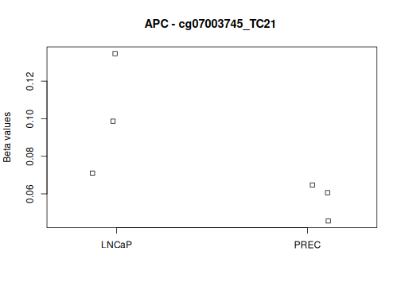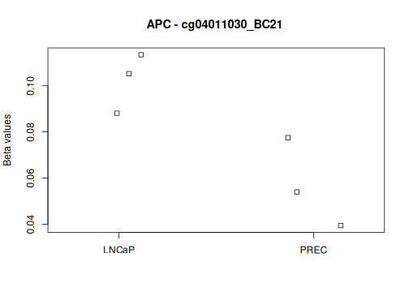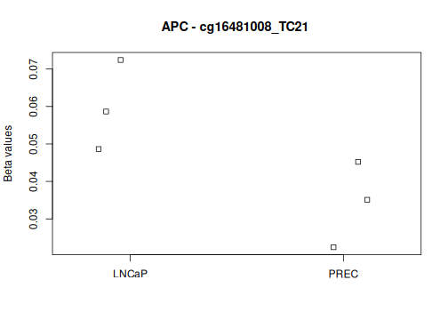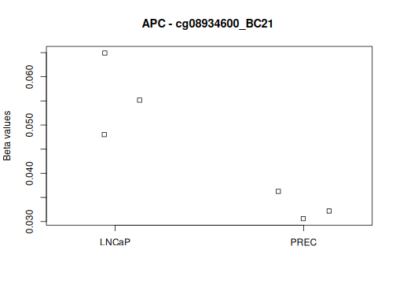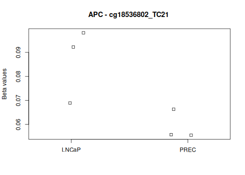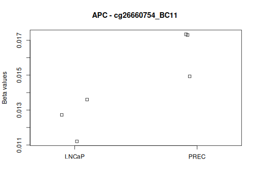

``` output
[[1]]
NULL

[[2]]
NULL

[[3]]
NULL

[[4]]
NULL

[[5]]
NULL

[[6]]
NULL

[[7]]
NULL

[[8]]
NULL
```

## Hierarchical clustering of the top CpG probes

We will use the top 100 most differentiated CpG sites (this can be changed depending on your preference). Rows in the heatmap represent probes and columns represent samples. The code uses Euclidean distances and Ward's clustering method, as in the example.


``` r
# extract top 100 DMPs
top_DMPs <- DMPs[1:100, ]

selected_bVals <- bVals[rownames(bVals) %in% rownames(top_DMPs), ]

# computing the distance matrix using Euclidean distance
dist_matrix <- dist(t(selected_bVals), method = "euclidean")

# Performing hierarchical clustering using Ward's method
hc <- hclust(dist_matrix, method = "ward.D2")

# Plot dendrogram
plot(hc, main = "Hierarchical Clustering of DMPs - LNCaP vs PrEC", sub = "", xlab = "", cex.lab = 0.75, cex.axis = 0.75, cex.main = 1)
```

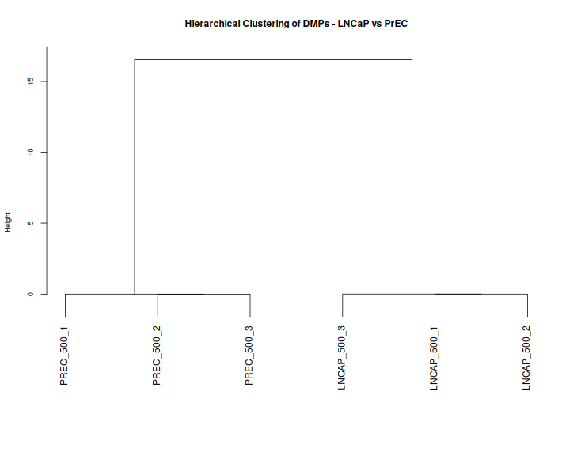

``` r
# Plot heatmap
sample_annotation <- HeatmapAnnotation(
  Cell_line = targets$Type,
  col = list(Cell_line = cols_type)
)

Heatmap(selected_bVals,
        top_annotation = sample_annotation,
        cluster_rows = TRUE,
        cluster_columns = TRUE,
        name = "Beta Value",
        column_title = "Hierarchical Clustering of Samples by Top 100 DMPs - LNCaP vs PrEC",
        row_title = "Top 100 CpG Sites",
        clustering_method_rows = "ward.D2",
        clustering_method_columns = "ward.D2",
        row_names_gp = grid::gpar(fontsize = 6)
)
```

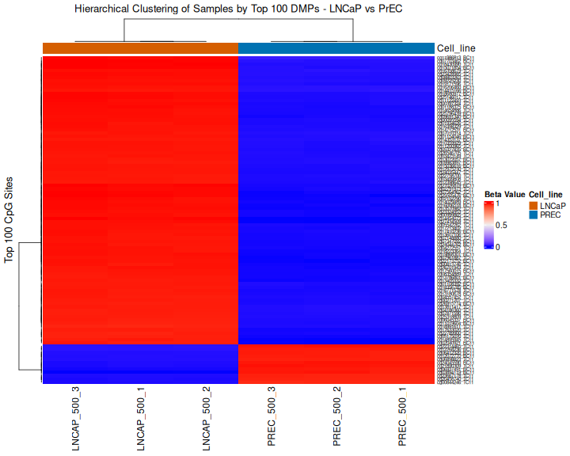

## Gene set enrichment and gene ontology testing

We can ask whether genes associated with significant CpG probes are enriched
for particular biological processes (**GO terms**) or **KEGG pathways**.
`gometh()` accounts for differences in the number of probes associated with
each gene. We use probes with `adj.P.Val < 0.05`, matching our false discovery rate of 5%. All tested probes will be used as the background.

The bias plots show how the probability of identifying a significant CpG varies with the number of probes associated with a gene. 
In the enrichment tables, inspect `FDR` to assess significance after testing many gene sets; the top ten terms are not necessarily significant.

Enrichment indicates that genes associated with differential methylation are overrepresented in a gene set. It does not establish that a pathway is activated or inhibited, or that gene expression has changed. This analysis combines probes with positive and negative methylation differences. 

This code requires a version of `missMethyl` that supports `array.type="EPIC_V2"`. See the
[missMethyl vignette](https://bioconductor.org/packages/release/bioc/vignettes/missMethyl/inst/doc/missMethyl.html)
for details, including recommendations for handling EPICv2 replicate probes
that measure the same CpG site. It is recommended that EPICv2 replicate probes are handelled before continuing with differential methylation analysis. Replicate probes in our dataset were collapsed in the previous lesson. 


``` r
# Extract significant probes at 5% FDR.
sigCpGs <- DMPs$Name[DMPs$adj.P.Val < 0.05]
sigCpGs[1:10]
```

``` output
 [1] "cg17560015_BC11" "cg19868301_BC11" "cg27434509_TC11" "cg27026819_BC11"
 [5] "cg05175020_TC11" "cg13786801_BC11" "cg23324953_TC11" "cg00095594_TC11"
 [9] "cg00999865_TC11" "cg17213402_TC11"
```

``` r
length(sigCpGs)
```

``` output
[1] 567733
```

``` r
# Background: all probes tested in this comparison.
allCpGs <- DMPs$Name
length(allCpGs)
```

``` output
[1] 852592
```

``` r
# GO enrichment analysis
par(mfrow=c(1,1))
gst <- gometh(sig.cpg=sigCpGs, all.cpg=allCpGs,
              array.type="EPIC_V2", collection="GO", plot.bias=TRUE)
```

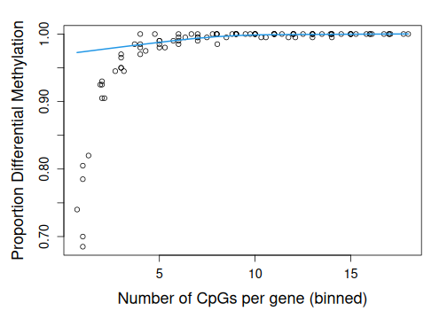

``` r
print(topGSA(gst, number=10))
```

``` output
           ONTOLOGY                               TERM     N    DE         P.DE
GO:0003674       MF                 molecular_function 17056 16921 5.399288e-82
GO:0005488       MF                            binding 15677 15565 1.685215e-77
GO:0005515       MF                    protein binding 13784 13701 9.445045e-73
GO:0110165       CC      cellular anatomical structure 17724 17540 8.954903e-58
GO:0005575       CC                 cellular_component 17998 17801 1.243279e-53
GO:0005737       CC                          cytoplasm 11149 11084 1.406102e-53
GO:0008150       BP                 biological_process 17009 16826 2.567379e-48
GO:0005622       CC intracellular anatomical structure 14469 14336 4.501325e-46
GO:0009987       BP                   cellular process 16566 16388 1.496443e-45
GO:0065007       BP              biological regulation 11562 11474 9.332261e-42
                    FDR
GO:0003674 1.143029e-77
GO:0005488 1.783800e-73
GO:0005515 6.665054e-69
GO:0110165 4.739382e-54
GO:0005575 4.961197e-50
GO:0005737 4.961197e-50
GO:0008150 7.764488e-45
GO:0005622 1.191163e-42
GO:0009987 3.519967e-42
GO:0065007 1.975640e-38
```

``` r
# KEGG enrichment analysis
gst.kegg <- gometh(sig.cpg=sigCpGs, all.cpg=allCpGs,
                   array.type="EPIC_V2", collection="KEGG", plot.bias=TRUE)
print(topGSA(gst.kegg, number=10))
```

``` output
                              Description    N   DE         P.DE         FDR
hsa01100               Metabolic pathways 1489 1480 1.054744e-05 0.003923647
hsa05200               Pathways in cancer  509  509 5.750207e-05 0.010695386
hsa05165   Human papillomavirus infection  321  321 2.157508e-03 0.267531017
hsa04010           MAPK signaling pathway  289  289 4.226717e-03 0.393084656
hsa04151       PI3K-Akt signaling pathway  343  342 9.266902e-03 0.539733492
hsa04142              Lysosome biogenesis  239  239 1.072015e-02 0.539733492
hsa04014            Ras signaling pathway  228  228 1.328740e-02 0.539733492
hsa04820     Cytoskeleton in muscle cells  225  225 1.412028e-02 0.539733492
hsa04810 Regulation of actin cytoskeleton  222  222 1.500577e-02 0.539733492
hsa05163  Human cytomegalovirus infection  217  217 1.500640e-02 0.539733492
```

::::::::::::::::::::::::::::::::::::: keypoints

- Use M-values for probe-wise modelling and beta values to describe methylation levels.
- The design encodes the groups; the contrast defines the comparison and effect direction.
- Investigate genes of interest by searching the annotation and selecting probes relevant to the biological question, such as promoter-associated CpG-island probes.
- Plot individual probes to compare methylation levels and variation within each group.
- Use hierarchical clustering and an annotated heatmap of the top-ranked probes to visualise methylation patterns and sample relationships.
- Explore GO and KEGG enrichment using significant probes and all tested probes as the background.

::::::::::::::::::::::::::::::::::::::::::::::::
